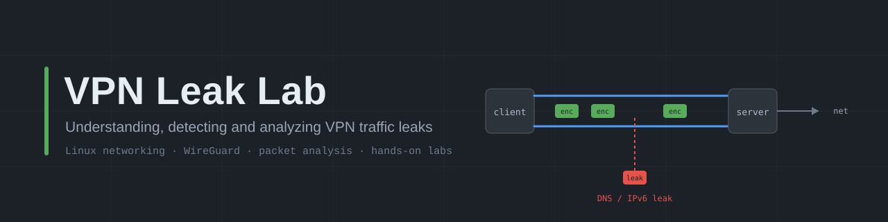
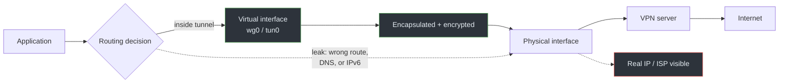
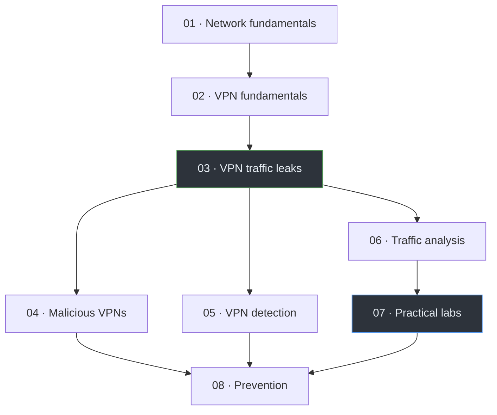

<div align="center">



# VPN Leak Lab

**Understanding, detecting and analyzing VPN traffic leaks**

A hands-on, Linux-first study of how VPNs work, how they leak, and how to
investigate both with ordinary networking tools.

[Learning path](#learning-path) · [Modules](#modules) · [Labs](#practical-labs) · [Glossary](resources/glossary.md) · [References](resources/references.md)

</div>

---

## What this is

A VPN is supposed to move *all* of your traffic through an encrypted tunnel.
In practice, small routing and configuration mistakes let some traffic escape
around the tunnel — your real IP, a DNS query, an IPv6 connection. Those are
**leaks**, and they quietly undo the privacy a VPN is meant to provide.

This repository teaches you to reason about those leaks from first principles.
It starts with the networking basics (addressing, routing, DNS, NAT), builds up
to how WireGuard and OpenVPN actually tunnel packets, then dissects seven
distinct leak classes. Finally, it gives you seven reproducible labs to observe
the behavior yourself on Debian with `ip`, `dig`, `tcpdump`, and Wireshark.

It is written for Computer Engineering and networking students who know their
way around a terminal but haven't yet internalized how packets move through a
Linux system. No prior VPN or packet-analysis experience is assumed.

> **Scope.** Everything here is defensive and educational. Labs run only in
> environments you control. There are no instructions for attacking services,
> intercepting other people's traffic, or bypassing platform security.

## Learning objectives

By the end you should be able to:

- Read a Linux routing table and predict which interface a packet will use.
- Explain what a VPN tunnel actually encapsulates, and what it does **not** hide.
- Distinguish a **leak** (traffic escaping the tunnel) from **detection**
  (a platform recognizing that you're using a VPN). These are different problems.
- Identify the root cause of DNS, IPv6, WebRTC, routing, and kill-switch leaks.
- Capture and interpret traffic before and after a VPN comes up.
- Reason about what a malicious or careless VPN provider can and cannot see.
- Apply and verify concrete hardening steps, including their trade-offs.

## Architecture at a glance

The core idea of the whole project in one picture: traffic should stay inside
the tunnel, and a leak is any path that leaves it.



The solid path is what a correctly configured VPN does. The dashed path is a
leak. Most of this repository is about understanding, finding, and closing that
dashed path.

## Learning path

The modules build on each other. If you're new to networking, go in order;
if you already know the basics, jump to Module 03.



## Modules

| # | Module | What you'll learn |
|---|--------|-------------------|
| 01 | [Network Fundamentals](docs/01-network-fundamentals/README.md) | Addressing, subnetting, interfaces, routing, DNS, NAT, packet flow |
| 02 | [VPN Fundamentals](docs/02-vpn-fundamentals/README.md) | Tunneling, encapsulation, WireGuard, OpenVPN, connection lifecycle |
| 03 | [VPN Traffic Leaks](docs/03-vpn-leaks/README.md) | Seven leak classes, their causes, detection, and prevention |
| 04 | [Malicious VPN Applications](docs/04-malicious-vpns/README.md) | Logging, manipulation, TLS interception, trust models |
| 05 | [VPN Detection](docs/05-vpn-detection/README.md) | How platforms identify VPN use: IP reputation, ASN, GeoIP, behavior |
| 06 | [Network Traffic Analysis](docs/06-traffic-analysis/README.md) | Wireshark, tcpdump, and reading real captures |
| 07 | [Practical Labs](docs/07-practical-labs/README.md) | Seven reproducible Debian labs |
| 08 | [Prevention & Best Practices](docs/08-prevention/README.md) | Hardening, verification checklists, and trade-offs |

## Practical labs

Seven labs, each with objectives, topology, step-by-step commands, expected
observations, troubleshooting, and cleanup. They use two Debian VMs and
WireGuard where possible. See the [lab index](docs/07-practical-labs/README.md)
for the shared environment setup.

| Lab | Focus | Key tools |
|-----|-------|-----------|
| [01](docs/07-practical-labs/lab-01-network-inspection.md) | Basic network inspection | `ip`, `ss`, `dig` |
| [02](docs/07-practical-labs/lab-02-vpn-interface-analysis.md) | VPN interface analysis | `ip`, `wg` |
| [03](docs/07-practical-labs/lab-03-routing-investigation.md) | Routing table investigation | `ip route`, `ip rule` |
| [04](docs/07-practical-labs/lab-04-dns-leak.md) | DNS leak investigation | `dig`, `resolvectl`, `tcpdump` |
| [05](docs/07-practical-labs/lab-05-ipv6-leak.md) | IPv6 leak investigation | `ip -6`, `curl`, `tcpdump` |
| [06](docs/07-practical-labs/lab-06-traffic-analysis.md) | Wireshark & tcpdump analysis | `tcpdump`, Wireshark |
| [07](docs/07-practical-labs/lab-07-kill-switch.md) | Kill switch testing | `nftables`, `ip`, `ping` |

> Lab outputs in this repository are **illustrative** unless explicitly marked
> as captured. Your addresses, interface names, and timing will differ.

## Tools & technologies

- **OS:** Debian-based Linux (primary), two VMs for the VPN labs
- **VPN:** WireGuard (preferred), OpenVPN (for comparison)
- **Inspection:** `iproute2` (`ip`, `ss`), `dig`, `resolvectl`, `curl`
- **Capture & analysis:** `tcpdump`, Wireshark / `tshark`
- **Firewall:** `nftables`
- **Scripting:** Bash, with a little Python where it genuinely helps
- **Diagrams:** Mermaid, plus hand-authored SVG

## Repository layout

```text
vpn-leak-lab/
├── docs/            Eight teaching modules (Markdown)
├── diagrams/        Mermaid sources used across the docs
├── labs/            Scripts, configs, and labeled sample captures
├── assets/          Banner and illustrations
└── resources/       References, RFC list, glossary
```

## References

Technical claims are cited near where they appear and collected in
[resources/references.md](resources/references.md). Key primary sources include
the IETF RFCs ([RFC list](resources/rfc-list.md)), the official
[WireGuard](https://www.wireguard.com/) and [OpenVPN](https://openvpn.net/)
documentation, and the Linux man pages. Unfamiliar terms are defined in the
[glossary](resources/glossary.md).

## Project status

All eight modules and seven labs are written and cross-linked. Lab outputs are
labeled illustrative; run the labs in your own VMs to capture real results.
Issues and corrections are welcome — see [CONTRIBUTING.md](CONTRIBUTING.md).

## Disclaimer

This project is for education and for testing systems you own or have explicit
permission to test. It does not endorse attacking third-party services,
evading lawful security controls, or intercepting traffic that isn't yours.
Networking behavior varies by kernel, distribution, and configuration; verify
everything in your own environment before relying on it.

Licensed under the [MIT License](LICENSE).