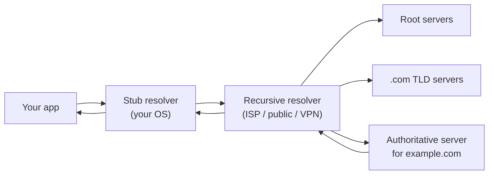

# 05 · DNS

Applications use names (`example.com`); networks use addresses. The Domain Name
System bridges the two. DNS is also the most common VPN leak, because name
resolution often takes a *different path* than the connection that follows it.
This chapter explains the machinery so the leak makes sense later.

## The resolution chain

When a program calls `getaddrinfo("example.com")`, the answer usually comes from
a **recursive resolver** — a server that does the legwork of walking the DNS
hierarchy on your behalf:



- The **stub resolver** is the lightweight client in your OS. It doesn't walk
  the hierarchy; it just asks one recursive resolver and waits.
- The **recursive resolver** (your ISP's, a public one like `9.9.9.9`, or the
  VPN's) queries root → TLD → authoritative servers, caching answers as it goes.
- The **authoritative server** holds the actual records for a domain.

> **CONCEPT**
> Whoever runs your recursive resolver learns every domain you look up. That's
> why "which resolver am I using?" is a privacy question, and why a VPN that
> tunnels your web traffic but leaves DNS at your ISP still exposes your
> browsing.

## Where the resolver is configured

On a modern Debian system using `systemd-resolved`, the effective configuration
is visible with:

```bash
resolvectl status
```

Illustrative output:

```text
Global
       Protocols: -DefaultRoute +LLMNR -mDNS
Link 2 (eth0)
      Current Scopes: DNS
           Protocols: +DefaultRoute +LLMNR -mDNS
        DNS Servers: 192.0.2.53
         DNS Domain: ~.
```

The `DNS Servers:` line is the resolver your queries go to. On simpler setups
the resolver is listed in `/etc/resolv.conf` as a `nameserver` line. When a VPN
connects, it should push its own resolver here (or set up split DNS). If
`192.0.2.53` (your ISP) is still the only server after the VPN is up, DNS is
going outside the tunnel.

> **TECHNICAL NOTE**
> `resolvectl` may not be installed on minimal systems; in that case read
> `/etc/resolv.conf` directly. Both tell you the same essential thing: which
> resolver the stub forwards to.

## Querying directly: `dig`

`dig` lets you bypass the stub and ask a specific resolver, which is exactly
what you need to test for leaks.

```bash
dig example.com                 # use the system resolver
dig @192.0.2.53 example.com     # ask a specific server
dig +short example.com          # just the answer
dig AAAA example.com            # ask for the IPv6 record
```

Illustrative `dig example.com` output (trimmed):

```text
;; ->>HEADER<<- opcode: QUERY, status: NOERROR, id: 4242
;; QUESTION SECTION:
;example.com.            IN    A

;; ANSWER SECTION:
example.com.        300    IN    A    203.0.113.80

;; Query time: 12 msec
;; SERVER: 192.0.2.53#53(192.0.2.53) (UDP)
```

Two lines matter most:

- `SERVER: 192.0.2.53#53` — the resolver that answered. If this is your ISP's
  address while the VPN is connected, you've found a DNS leak.
- The transport `(UDP)` and port `#53` — classic DNS is plaintext UDP (or TCP)
  on port 53, trivially observable in a capture.

> **IMPORTANT**
> Seeing a particular resolver's address in `dig` output is a *hint*, not proof
> of a leak on its own. A resolver can be reached *through* the tunnel (fine) or
> *outside* it (leak). To be sure, combine `dig` with a packet capture on the
> physical interface — that's exactly what
> [Lab 04](../07-practical-labs/lab-04-dns-leak.md) does.

## Encrypted DNS changes the picture

Two extensions hide DNS content from on-path observers:

- **DNS over TLS (DoT)** — DNS inside TLS, typically on port 853
  ([RFC 7858](https://www.rfc-editor.org/rfc/rfc7858)).
- **DNS over HTTPS (DoH)** — DNS inside HTTPS on port 443
  ([RFC 8484](https://www.rfc-editor.org/rfc/rfc8484)).

With either, a capture no longer shows readable queries on UDP/53 — you see
encrypted TLS instead. This is good for privacy but changes how you *detect*
leaks: you can't just grep for port 53 anymore. You have to check which resolver
the encrypted channel goes to, and whether that path is inside the tunnel.

## What to look for

- Run `resolvectl status` (or read `/etc/resolv.conf`) before and after the VPN.
  Did the resolver change to one the VPN controls?
- Use `dig` and read the `SERVER:` line. Then confirm the path with a capture.
- Remember DoH/DoT: absence of port-53 traffic does **not** mean DNS isn't
  leaking — it may just be encrypted.

## References

- [RFC 1034 — Domain Names: Concepts](https://www.rfc-editor.org/rfc/rfc1034)
- [RFC 1035 — DNS Implementation](https://www.rfc-editor.org/rfc/rfc1035)
- [RFC 7858 — DNS over TLS](https://www.rfc-editor.org/rfc/rfc7858)
- [RFC 8484 — DNS over HTTPS](https://www.rfc-editor.org/rfc/rfc8484)
- Linux man pages: [`resolvectl(1)`](https://man7.org/linux/man-pages/man1/resolvectl.1.html),
  [`resolv.conf(5)`](https://man7.org/linux/man-pages/man5/resolv.conf.5.html)

---

Next: [06 · NAT & Packet Flow](06-nat-and-packet-flow.md) ·
Back: [Module index](README.md)