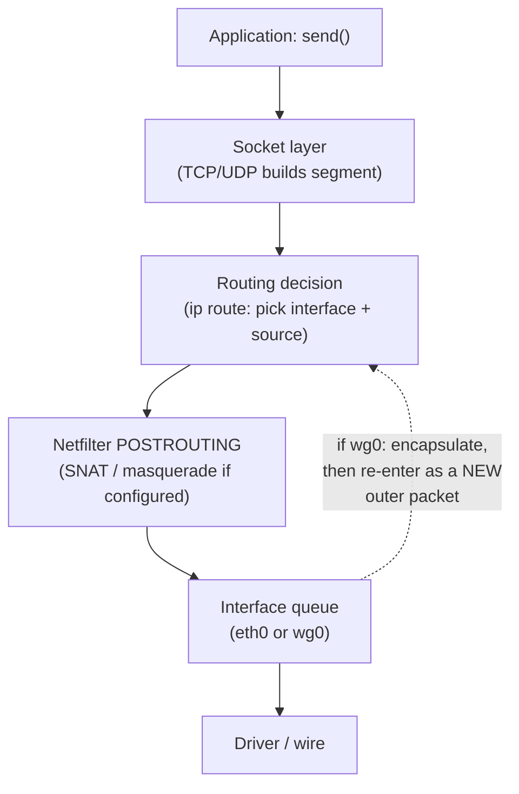

# 06 · NAT & Packet Flow

This chapter ties the previous ones together: the transport protocols that ride
on IP, the address translation that lets private networks reach the Internet,
and the actual path a packet takes through a Linux system. It's the last stop
before we add a VPN to the picture.

## TCP and UDP in one paragraph each

**TCP** is connection-oriented and reliable. Before data flows, the endpoints
do a three-way handshake (SYN → SYN-ACK → ACK); then TCP numbers bytes,
retransmits losses, and delivers an ordered stream. Most web traffic (HTTP/1.1,
HTTP/2 over TLS) uses TCP.

**UDP** is connectionless datagrams: no handshake, no ordering, no
retransmission. It's cheaper and lower-latency, which is why DNS classically uses
it, and why WireGuard tunnels over UDP. QUIC (HTTP/3) also runs over UDP.

Both use **ports** (0–65535) to tell applications apart on the same host. A
connection is identified by the 4-tuple *(source IP, source port, destination
IP, destination port)*.

> **CONCEPT**
> You can watch the TCP handshake in a capture — three small packets before any
> data. We do exactly that in
> [Module 06](../06-traffic-analysis/02-inspecting-dns-and-tcp.md). UDP has no
> such preamble; a DNS query is often a single request packet and a single
> reply.

## See what's listening: `ss`

`ss` shows sockets. The common inspection form is:

```bash
ss -tulpn
```

Flags: `-t` TCP, `-u` UDP, `-l` listening only, `-p` show the owning process,
`-n` numeric (don't resolve names). Illustrative output:

```text
Netid State  Recv-Q Send-Q Local Address:Port  Peer Address:Port Process
udp   UNCONN 0      0      127.0.0.53:53       0.0.0.0:*         users:(("systemd-resolve",pid=612,fd=13))
tcp   LISTEN 0      128    0.0.0.0:22          0.0.0.0:*         users:(("sshd",pid=801,fd=3))
```

The local `systemd-resolved` listener on `127.0.0.53:53` is the stub resolver
from [chapter 05](05-dns.md) — your apps talk to it, and it forwards to the real
resolver. Reading `-p` output usually needs root to see process names for
sockets you don't own.

## NAT: sharing one public address

Because IPv4 addresses are scarce, most networks use private addresses
internally and translate them at the edge. **NAT** (Network Address Translation)
rewrites addresses in packets as they cross a router.

- **SNAT** (source NAT) rewrites the *source* address of outgoing packets. Your
  home router replaces `192.168.1.10` with its public address so replies can
  find their way back. A common special case is **masquerading**, where the
  source becomes whatever address the outgoing interface has.
- **DNAT** (destination NAT) rewrites the *destination* address of incoming
  packets — this is how port forwarding sends traffic to an internal server.

NAT depends on **connection tracking**: the router remembers each flow
(the 4-tuple) so it can reverse the translation for returning packets.

> **TECHNICAL NOTE**
> A VPN server does SNAT too. Your tunneled packets arrive with the tunnel's
> inner source (e.g. `10.8.0.2`); the server rewrites that to its own public
> address before forwarding to the Internet. That's why a remote site sees the
> VPN server's IP, not yours. If the server *doesn't* do this correctly, replies
> can't route back — a broken tunnel, not a leak.

## A packet's path through Linux

Here's the journey of an outgoing packet, simplified but accurate:



The key points:

1. The **routing decision** (chapter 04) happens once per packet and chooses the
   interface and source address. This is where a leak is decided.
2. **Netfilter** hooks (the framework behind `nftables`/`iptables`) can inspect
   and rewrite packets. SNAT happens at `POSTROUTING`, just before the packet
   leaves; DNAT happens at `PREROUTING` on the way in.
3. If the chosen interface is a **tunnel**, the packet is handed to the VPN
   software, encapsulated, and the *outer* packet goes through the whole path
   again — this time destined for the VPN server.

Incoming packets reverse the flow: interface → `PREROUTING` (DNAT) → routing
decision → local delivery or forwarding.

> **IMPORTANT**
> A VPN kill switch is built on these Netfilter hooks: it installs rules that
> drop anything leaving the physical interface unless it's the tunnel's own
> encapsulated traffic. If those rules are missing or wrong, traffic flows the
> moment the tunnel drops. That's [Module 03, chapter 07](../03-vpn-leaks/07-kill-switch-failures.md).

## What to look for

- Run `ss -tulpn` and find the local DNS stub listener.
- Understand that your public IPv4 is usually the *router's*, applied via SNAT —
  which is why "what's my IP" services report the router's address.
- Remember the order: **routing first, then translation, then interface.** A
  leak is a routing decision that picks the physical interface when it shouldn't.

## References

- [RFC 793 — TCP](https://www.rfc-editor.org/rfc/rfc793)
- [RFC 768 — UDP](https://www.rfc-editor.org/rfc/rfc768)
- [RFC 3022 — Traditional NAT](https://www.rfc-editor.org/rfc/rfc3022)
- [RFC 2663 — NAT Terminology](https://www.rfc-editor.org/rfc/rfc2663)
- Linux man pages: [`ss(8)`](https://man7.org/linux/man-pages/man8/ss.8.html),
  [`nft(8)`](https://man7.org/linux/man-pages/man8/nft.8.html)

---

Next: [Module 02 · VPN Fundamentals](../02-vpn-fundamentals/README.md) ·
Back: [Module index](README.md)