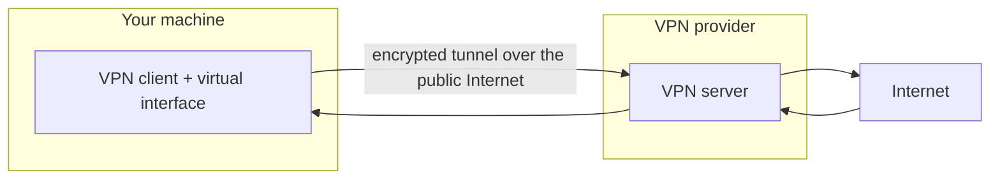

# 01 · What a VPN Actually Does

"VPN" stands for Virtual Private Network, but the name oversells it. A VPN
builds a *virtual* network link across a *public* one, so your machine behaves as
if it were directly attached to a remote private network. That's a precise,
limited capability — not an invisibility cloak.

## The client/server model

Two pieces cooperate:

- The **client** runs on your machine. It creates a virtual interface, installs
  routes, and encrypts/encapsulates outgoing packets.
- The **server** runs somewhere else (a datacenter, usually). It decrypts,
  decapsulates, and forwards your packets to the Internet, then relays replies
  back through the tunnel.

The remote destination sees the **server's** IP address. Your ISP sees an
encrypted stream to the server, but not the individual sites inside it. Those
are the two privacy benefits a VPN actually delivers.

## What a VPN does not do

Being clear about the limits prevents most misconceptions:

- It doesn't hide traffic that isn't routed into the tunnel (the whole of
  [Module 03](../03-vpn-leaks/README.md)).
- It doesn't make you anonymous to the *VPN provider* — the server still sees
  your real source address and the destinations you contact.
- It doesn't decrypt or protect application-layer content beyond the tunnel.
  HTTPS is still what protects the content end-to-end.
- It doesn't stop browser-level disclosures like WebRTC by itself.

> **CONCEPT**
> A VPN shifts *who* can observe your traffic. Without one, your ISP and anyone
> on the local network can see destinations. With one, they see only the tunnel;
> the provider now occupies that observational position. Trust moves — it
> doesn't disappear. This is why [Module 04](../04-malicious-vpns/README.md)
> treats provider trust as a first-class concern.

## Full tunneling vs split tunneling

The routing policy decides how much traffic enters the tunnel:

- **Full tunnel:** every destination is routed into the VPN. This is what you
  want for privacy. Technically it means the default route (or covering `/1`
  routes) points at the tunnel, for *both* IPv4 and IPv6.
- **Split tunnel:** only some destinations use the VPN; the rest go out the
  physical interface directly. This is common in corporate setups (only company
  subnets go through the VPN) and is sometimes offered by consumer clients to
  keep local devices or streaming fast.

Split tunneling is a legitimate design choice, but every excluded destination is
a deliberate bypass. The risk is when the exclusion is broader than the user
realizes, or when DNS/IPv6 are excluded by accident. We treat that in
[chapter 06 of Module 03](../03-vpn-leaks/06-split-tunneling-risks.md).

> **TECHNICAL NOTE**
> You can tell which mode you're in from the routing table. A full tunnel shows
> the default route (or `0.0.0.0/1` + `128.0.0.0/1`) via the tunnel interface. A
> split tunnel shows only specific prefixes via the tunnel, with the normal
> default still on the physical interface. `ip route get <destination>` tells
> you the truth for any particular target.

## Encryption vs tunneling

These are related but distinct, and the next chapter separates them carefully:

- **Tunneling** is the encapsulation trick — carrying one packet inside another
  so it can cross a network that wouldn't normally route it.
- **Encryption** is what makes the carried payload unreadable to observers.

A tunnel *can* be unencrypted (some corporate setups), and encryption *can*
exist without a tunnel (plain HTTPS). A privacy VPN combines both. Don't assume
"tunneled" automatically means "encrypted," or vice versa.

## References

- [RFC 7359 — VPN Traffic Leakage (problem statement)](https://www.rfc-editor.org/rfc/rfc7359)
- [WireGuard: fast, modern, secure tunnel](https://www.wireguard.com/)
- [OpenVPN documentation](https://openvpn.net/community-resources/)

---

Next: [02 · Tunneling & Encapsulation](02-tunneling-and-encapsulation.md) ·
Back: [Module index](README.md)