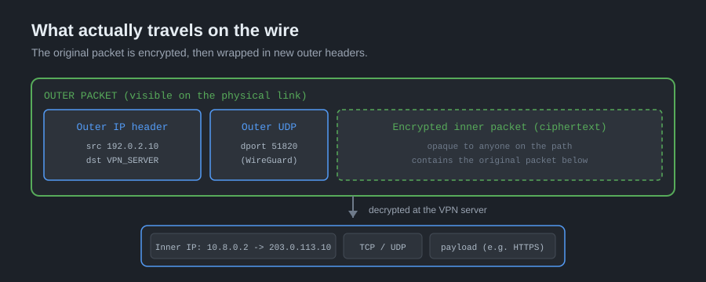
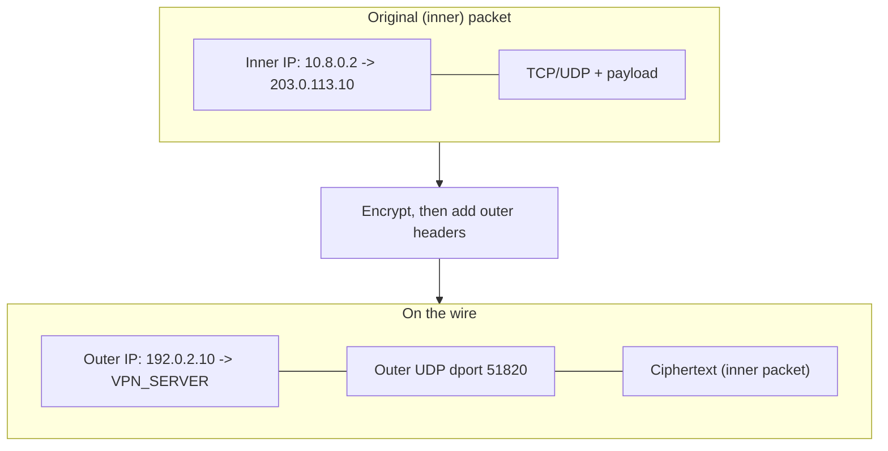
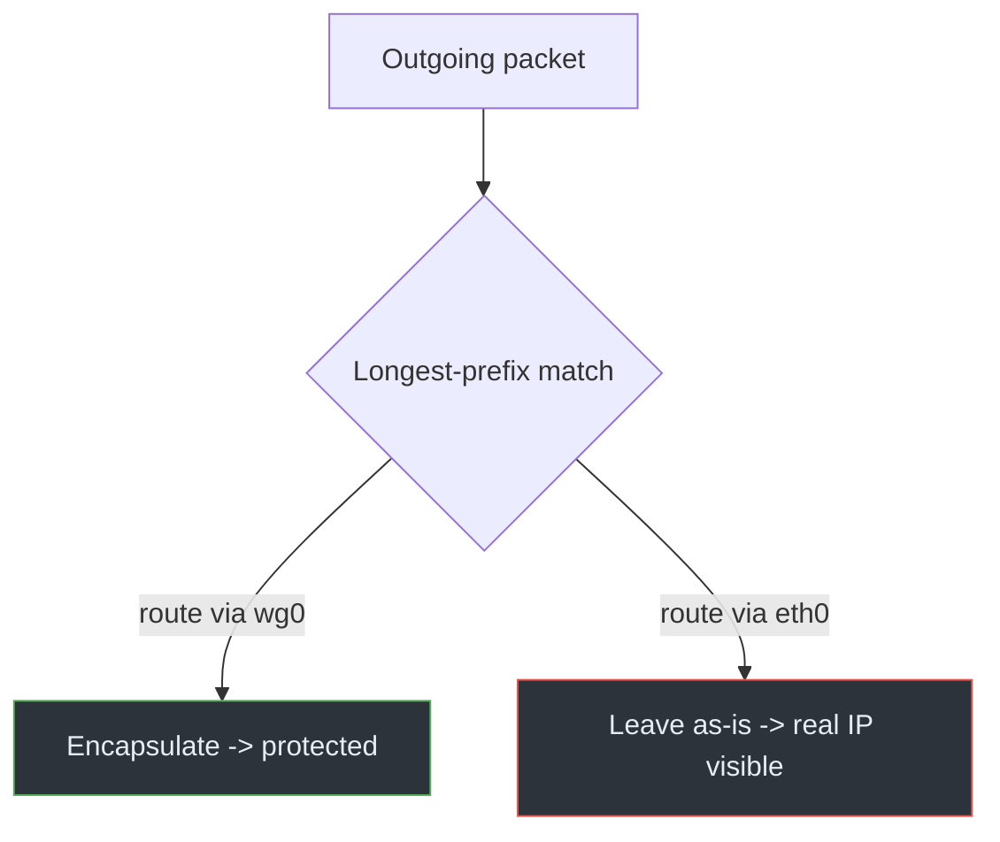

# 02 · Tunneling & Encapsulation

This is the mechanical heart of a VPN. Once you can picture a packet being
wrapped inside another packet, the rest of the project — including every leak —
becomes much easier to reason about.

## Encapsulation, step by step

Start with an ordinary packet your browser wants to send to `203.0.113.10`.
Without a VPN it would leave `eth0` with your real source address. With a VPN:

1. Routing sends the packet to the tunnel interface (`wg0`) instead of `eth0`.
2. The VPN client takes the **entire original IP packet** and encrypts it.
3. It prepends **new outer headers**: an outer IP header addressed to the VPN
   server, and an outer transport header (UDP for WireGuard).
4. This outer packet is what actually travels across the Internet.
5. The server strips the outer headers, decrypts, and forwards the original
   packet onward.

*Illustration: the inner packet (blue) becomes opaque ciphertext (green, dashed)
inside a new outer IP/UDP packet. Only the outer headers are visible on the
physical link.*

The Mermaid version of the same idea:

> **CONCEPT**
> Observers on the physical path (your ISP, a café Wi-Fi operator) see only the
> **outer** headers: your real IP talking to the VPN server, carrying opaque
> ciphertext. They cannot read the inner destination or payload. That's the
> protection. Anything that *doesn't* get wrapped this way is exposed.

## What the outer headers reveal

Encapsulation hides the inside, not the existence of the tunnel. An observer
still learns:

- Your real source IP (the outer source).
- The VPN server's IP and port (the outer destination).
- Timing and volume of traffic.
- Often the *protocol* — WireGuard's UDP/51820 is recognizable, which is how
  [VPN detection](../05-vpn-detection/README.md) and network filtering work.

So a VPN hides *content and inner destination* from the local path, but not the
*fact* of a tunnel. Detection and leakage are different problems; don't conflate
them.

## tun vs tap

Virtual tunnel interfaces come in two flavors:

- **`tun`** operates at layer 3 (IP). It carries routed IP packets. WireGuard and
  routed OpenVPN use this. It's the common choice for privacy VPNs.
- **`tap`** operates at layer 2 (Ethernet). It carries full frames, so it can
  bridge a remote LAN as if you were plugged into the same switch. Bridged
  OpenVPN uses this.

The distinction matters because a `tun` interface only carries what routing
sends to it — reinforcing that routing, not the interface itself, decides what
is protected.

## VPN routing recap

Encapsulation only helps packets that reach the tunnel. The routing table is
the gatekeeper:

A full-tunnel VPN must win the routing decision for *all* destinations you care
about, in *both* address families. Every gap is a leak.

## MTU: the practical wrinkle

Wrapping a packet adds bytes (outer IP + UDP + crypto overhead). If the inner
packet is already at the 1500-byte Ethernet MTU, the outer packet won't fit.
Clients handle this by lowering the tunnel MTU (WireGuard commonly uses 1420)
and relying on path MTU discovery. A too-large MTU shows up as "connected, but
some pages hang" — small transfers work, large ones stall.

## References

- [RFC 7359 — VPN Traffic Leakage](https://www.rfc-editor.org/rfc/rfc7359)
- [WireGuard protocol description](https://www.wireguard.com/protocol/)
- Linux man pages: [`ip-tuntap(8)`](https://man7.org/linux/man-pages/man8/ip-tuntap.8.html)

---

Next: [03 · WireGuard](03-wireguard.md) ·
Back: [Module index](README.md)