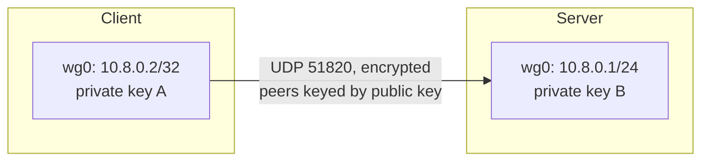

# 03 · WireGuard

WireGuard is the VPN we use for the main labs. It's worth understanding on its
own terms: it's deliberately small, built from modern primitives, and models a
tunnel differently from older VPNs. This chapter describes its architecture; the
hands-on setup lives in [Lab 02](../07-practical-labs/lab-02-vpn-interface-analysis.md).

## The shape of a WireGuard tunnel

WireGuard creates a layer-3 interface (typically `wg0`) and sends encrypted
packets to peers over **UDP** (default port 51820). There is no TCP connection
and no TLS handshake — the tunnel is a stream of encrypted UDP datagrams.

Each interface has a **Curve25519 key pair**. Peers are identified by their
public keys, not by usernames or certificates. You exchange public keys out of
band (config file, QR code) before the tunnel can work.



## Cryptokey routing

WireGuard's routing idea is called **cryptokey routing**. Each peer entry lists
the public key plus the set of **Allowed IPs** that peer handles. When a packet
leaves `wg0`, WireGuard looks at the destination, finds the peer whose Allowed
IPs cover it, and encrypts to that peer's key. Incoming packets are only
accepted if they decrypt correctly with a configured peer's key.

For a full-tunnel client, the server's Allowed IPs are `0.0.0.0/0, ::/0` — send
everything to that one peer. This is the WireGuard way of expressing "route all
traffic into the tunnel," and it's exactly the setting to check when hunting
leaks.

> **TECHNICAL NOTE**
> Allowed IPs do double duty: they're both a routing statement (which
> destinations go to this peer) and an access-control statement (which source
> addresses this peer may send from). A misconfigured Allowed IPs list is a
> common cause of "the tunnel is up but nothing routes."

## Cryptography, briefly

WireGuard fixes a small, modern cipher suite rather than negotiating options:

- **Curve25519** for key exchange.
- **ChaCha20-Poly1305** for authenticated encryption of data.
- **BLAKE2s** for hashing.
- A **Noise_IK**-style handshake for mutual authentication and forward secrecy.

The handshake is lightweight and the protocol is "silent" when idle — there's
no chatty control connection to observe. This simplicity is a big part of why
the codebase is small and auditable compared with older VPNs.

## What WireGuard does *not* do

By design, the core protocol leaves several jobs to surrounding tooling:

- It doesn't assign addresses or push routes by itself. The helper script
  **`wg-quick`** reads a config, brings the interface up, adds the address,
  installs routes, and can set DNS.
- It doesn't authenticate users beyond possession of the private key.
- It doesn't do its own key distribution — you arrange that separately.

This separation is why the *configuration* (routes, DNS, Allowed IPs) is where
leaks are introduced, not the cryptography.

## A minimal client config

Here's the structure of a `wg-quick` client config. **All keys and addresses are
placeholders — never use real secrets in examples.** The runnable, placeholder
version lives in [`labs/configs/`](../../labs/configs/).

```ini
[Interface]
PrivateKey = <CLIENT_PRIVATE_KEY>
Address    = 10.8.0.2/32
DNS        = 10.8.0.1

[Peer]
PublicKey           = <SERVER_PUBLIC_KEY>
Endpoint            = vpn.example.test:51820
AllowedIPs          = 0.0.0.0/0, ::/0
PersistentKeepalive = 25
```

Reading it:

- `Address` is the inner tunnel address.
- `DNS` tells `wg-quick` which resolver to use while the tunnel is up — setting
  this correctly is central to [DNS-leak prevention](../03-vpn-leaks/02-dns-leaks.md).
- `AllowedIPs = 0.0.0.0/0, ::/0` makes it a full tunnel for both families.
- `PersistentKeepalive` sends a small packet periodically to keep NAT mappings
  alive (useful behind a home router).

## Inspecting a live tunnel

```bash
sudo wg show
```

Illustrative output:

```text
interface: wg0
  public key: <CLIENT_PUBLIC_KEY>
  private key: (hidden)
  listening port: 51820

peer: <SERVER_PUBLIC_KEY>
  endpoint: 198.51.100.5:51820
  allowed ips: 0.0.0.0/0, ::/0
  latest handshake: 12 seconds ago
  transfer: 4.20 MiB received, 1.10 MiB sent
```

`latest handshake` and a growing `transfer` count tell you the tunnel is really
passing traffic. `allowed ips` confirms what's being routed. `wg` needs root to
show private-key-adjacent details.

## References

- [WireGuard official site](https://www.wireguard.com/)
- [WireGuard protocol & whitepaper](https://www.wireguard.com/protocol/)
- [WireGuard quick-start](https://www.wireguard.com/quickstart/)
- Linux man pages: [`wg(8)`](https://man7.org/linux/man-pages/man8/wg.8.html),
  [`wg-quick(8)`](https://man7.org/linux/man-pages/man8/wg-quick.8.html)

---

Next: [04 · OpenVPN](04-openvpn.md) ·
Back: [Module index](README.md)