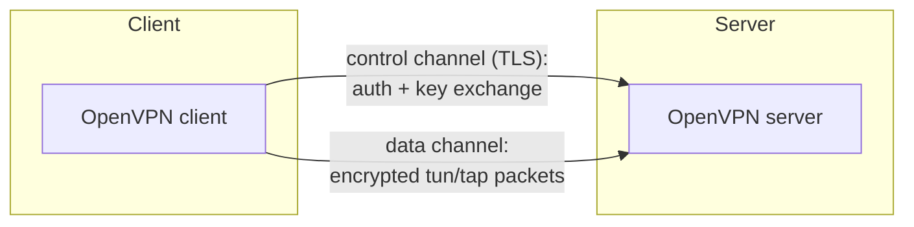

# 04 · OpenVPN

OpenVPN is the long-established, highly configurable VPN. We cover it for
contrast: it solves the same problem as WireGuard but with a different design,
and the differences matter when you reason about leaks and detection. The labs
use WireGuard, so this chapter is about understanding, not setup.

## Two channels, not one

OpenVPN separates its work into two logical channels:

- A **control channel**, protected by TLS, handles authentication, certificate
  verification, and the negotiation/exchange of keys.
- A **data channel** carries the actual tunneled packets, encrypted with the
  symmetric keys agreed on the control channel.

This is a real architectural difference from WireGuard's single silent UDP
stream. OpenVPN's TLS handshake is observable and negotiable; WireGuard's is
fixed and minimal.

## Transport and mode

- **Transport:** OpenVPN runs over **UDP** (default port 1194, preferred) or
  **TCP** (useful to get through networks that block UDP, at the cost of
  performance — tunneling TCP over TCP causes meltdowns under loss).
- **Device mode:** `tun` for routed IP (the common privacy setup) or `tap` for
  bridged Ethernet (act like you're on the remote LAN).

Because it can ride TCP/443, OpenVPN is sometimes used to blend in with HTTPS —
a reminder that *appearance* of traffic and *protection* of traffic are separate
topics.

## Authentication and configuration

OpenVPN typically uses a **PKI**: a certificate authority signs server and
client certificates, and each side verifies the other. It can also combine
username/password or use static keys. Configuration is a `.ovpn` file plus
certificates and keys.

That flexibility is a double-edged sword: there are many more knobs (cipher
choice, compression, `redirect-gateway`, DNS push, scripts) and therefore many
more ways to misconfigure routing or DNS into a leak.

> **TECHNICAL NOTE**
> The directive that makes OpenVPN a full tunnel is `redirect-gateway` (often
> `redirect-gateway def1`). `def1` adds the two covering `/1` routes instead of
> replacing the default — the same trick described in
> [Module 01, routing](../01-network-fundamentals/04-routing.md). If a client
> omits it, you get a split tunnel whether you intended one or not.

## WireGuard vs OpenVPN, honestly

They are not interchangeable, and it's wrong to assume all VPN protocols behave
identically:

| Aspect | WireGuard | OpenVPN |
|--------|-----------|---------|
| Transport | UDP only | UDP or TCP |
| Handshake | Fixed Noise-style, minimal | TLS, negotiable |
| Identity | Public keys | Certificates / PKI (usually) |
| Cipher choice | Fixed modern suite | Configurable |
| Code size | Small | Large |
| Roaming | Built-in, endpoint updates | Reconnect-oriented |
| Kernel | In-kernel (Linux) | Userspace |

Neither is "the same tunnel with a different label." Their handshake
observability, port usage, and configuration surfaces differ, which affects both
[detection](../05-vpn-detection/README.md) and where leaks creep in.

## References

- [OpenVPN community documentation](https://openvpn.net/community-resources/)
- [OpenVPN how-to](https://openvpn.net/community-resources/how-to/)
- [RFC 8446 — TLS 1.3](https://www.rfc-editor.org/rfc/rfc8446) (the basis of the
  control channel on modern deployments)

---

Next: [05 · Connection Lifecycle](05-connection-lifecycle.md) ·
Back: [Module index](README.md)