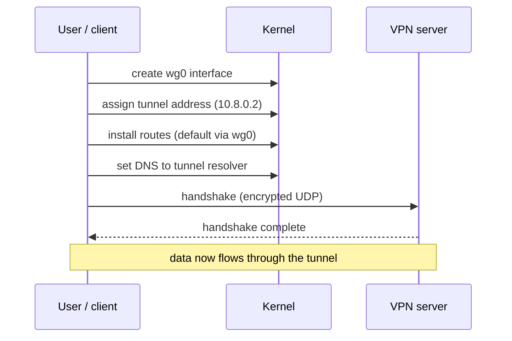

# 05 · Connection Lifecycle

A VPN isn't a static thing you switch on; it's a sequence of steps, and the
*ordering* of those steps creates brief windows where traffic can escape.
Understanding the lifecycle is what makes kill switches and reconnect leaks
make sense.

## Bringing a tunnel up

Using WireGuard via `wg-quick` as the concrete example, "connect" roughly does:



The exact order varies by client, but the ingredients are the same: interface,
address, routes, DNS, then a cryptographic handshake. Two observations matter:

- **Routes and DNS are installed by the client, not by the protocol.** If the
  client forgets IPv6 routes or leaves DNS alone, the tunnel still "connects"
  while leaking. A green "connected" indicator is not proof of a full tunnel.
- **There's a gap between interface-up and routes-fully-installed.** Traffic
  generated in that gap may use the old (physical) routes.

## While connected

Once up, the tunnel needs to stay alive:

- WireGuard is quiet when idle; a `PersistentKeepalive` keeps NAT mappings open.
- If your physical IP changes (Wi-Fi → wired, or a new DHCP lease), WireGuard
  can *roam* — the server learns the new endpoint from authenticated packets.
- The client may periodically re-resolve the server's endpoint hostname.

## Teardown and reconnect: the danger windows

When the tunnel drops — server restart, network change, suspend/resume — the
client must tear down routes and (ideally) block traffic until the tunnel is
back. The risky moments:

1. **Tunnel down, routes removed:** the old default route via the physical
   interface may become active again. Without a kill switch, traffic flows in
   the clear immediately.
2. **Reconnecting:** packets sent before routes are reinstalled take the
   physical path.
3. **DNS during the gap:** the resolver may revert to the ISP's, leaking queries
   even for the instant before the tunnel returns.

> **WARNING**
> These windows are exactly what a **kill switch** is meant to close: firewall
> rules that drop non-tunnel traffic regardless of route state. If the kill
> switch is absent, misconfigured, or only covers IPv4, the gaps leak. See
> [Module 03, chapter 07](../03-vpn-leaks/07-kill-switch-failures.md) and
> [Lab 07](../07-practical-labs/lab-07-kill-switch.md).

## Verifying the lifecycle yourself

You can watch the state change with ordinary tools:

```bash
ip -brief addr          # wg0 appears / disappears
ip route                # default route moves to / from wg0
resolvectl status       # resolver changes
sudo wg show            # latest handshake, transfer counters
```

Run these in a loop while you connect and disconnect, and you'll see the
lifecycle directly. That's the basis of
[Lab 02](../07-practical-labs/lab-02-vpn-interface-analysis.md).

## References

- [WireGuard quick-start](https://www.wireguard.com/quickstart/)
- [`wg-quick(8)`](https://man7.org/linux/man-pages/man8/wg-quick.8.html)
- [RFC 7359 — VPN Traffic Leakage](https://www.rfc-editor.org/rfc/rfc7359)

---

Next: [Module 03 · VPN Traffic Leaks](../03-vpn-leaks/README.md) ·
Back: [Module index](README.md)