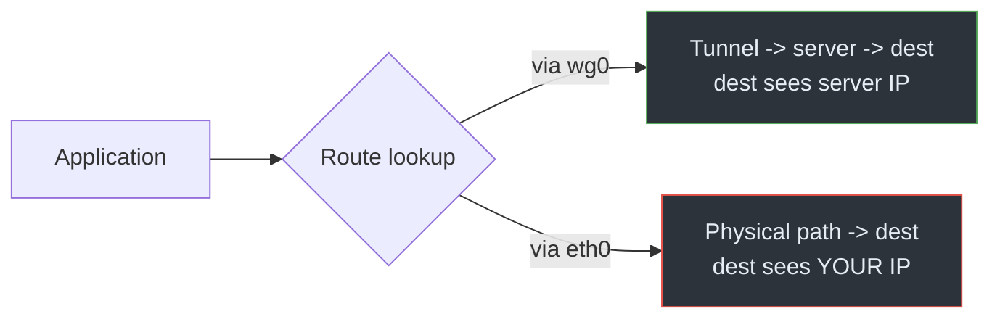

# 01 · Public IP Leaks

## Overview

A public IP leak is the most direct failure: a connection reaches its destination
carrying your **real public IPv4 address** instead of the VPN server's. The
remote server — and anyone observing the path — sees who you actually are (at
least to the granularity of your ISP and approximate location). Everything else
the VPN does is undermined for that connection.

## Technical background

Recall from [Module 01](../01-network-fundamentals/06-nat-and-packet-flow.md)
that the source address of an outgoing packet is chosen by the kernel during the
routing decision. For a normal connection out `eth0`, that source is your public
IPv4 (or your router's, via NAT). For a tunneled connection, the *inner* packet
has the tunnel address, and the server rewrites it to the server's public IP
before forwarding.

So the destination sees whichever source address survives to the final hop. If
a packet never enters the tunnel, its source is your real address, full stop.

> **CONCEPT**
> The destination sees the source address of the packet that *actually arrives*.
> Encapsulation only protects packets that go through the tunnel. There is no
> retroactive hiding: a packet sent out `eth0` is already exposed.

## How it works

A public IP leak happens whenever a connection's routing decision selects the
physical interface instead of the tunnel. Common triggers:

- The VPN's routes don't cover the destination (incomplete full tunnel).
- The tunnel dropped and the old default route became active again.
- An application binds to a specific interface or source address, bypassing the
  tunnel's routing.
- The connection was established *before* the VPN came up and persists afterward
  (long-lived connections keep their original path).

## Packet / traffic flow

```text
Normal (protected):
  app -> wg0 (src 10.8.0.2) -> [encapsulate] -> server -> SNAT to server IP -> dest
  dest sees: VPN_SERVER_IP

Leaked:
  app -> eth0 (src 192.0.2.10) -> router SNAT -> dest
  dest sees: YOUR_PUBLIC_IP
```

The difference is entirely in the first routing decision. Once the packet is on
`eth0`, no later step re-hides it.

## Architecture diagram



## Root causes

- **Incomplete routing coverage** — missing default or `/1` routes (see
  [routing leaks](05-routing-leaks.md)).
- **Tunnel-down windows** — no kill switch (see
  [kill switch failures](07-kill-switch-failures.md)).
- **Pre-existing connections** — sockets opened before the VPN keep their path.
- **Interface/source binding** — apps that force `eth0` or a specific source.
- **IPv4-only thinking** — assuming IPv6 is covered too (it often isn't; see
  [IPv6 leaks](03-ipv6-leaks.md)).

## Practical scenario

You connect a VPN, then open a "what is my IP" page. It reports the VPN's
address — good. But a background application that started *before* the VPN
connected keeps a long-lived connection out the physical interface. A service it
talks to still sees your real IP. The browser test passes while a real leak
persists, because the test only checks *new* connections.

This is why a single "what is my IP" check is necessary but not sufficient.

## Detection methods

- Ask an external service what source address it sees, for **new** connections:
  ```bash
  curl -4 https://example.test/ip     # use a service you control or trust
  ```
  (Replace with a real IP-echo service; the point is to compare the reported
  address against the VPN exit.)
- Predict the path locally without contacting anyone:
  ```bash
  ip route get 203.0.113.10
  ```
  If it resolves to `eth0` while the VPN is up, that destination leaks.
- Capture on the physical interface and look for non-tunnel traffic to public
  destinations ([Module 06](../06-traffic-analysis/README.md)).
- List established sockets and their local addresses with `ss -tnp`; a
  connection whose local address is your physical IP (not the tunnel IP) is
  suspect.

## Prevention techniques

- Use a true full tunnel for both families (verify with `ip route get`).
- Enable a kill switch so tunnel-down windows can't leak.
- Restart long-lived applications after connecting, or use a client that
  re-binds connections.
- Avoid apps that hard-bind to the physical interface unless you intend it.
- Verify with a capture, not just a single IP-echo page.

## Common misconceptions

- *"The IP check passed, so nothing leaks."* It only tested one new connection.
  Existing sockets, other apps, and IPv6 may still leak.
- *"A VPN always hides my IP."* Only for traffic it actually routes into the
  tunnel. Configuration decides.
- *"Leaking means the encryption broke."* No — the encryption is fine; the
  packet simply never entered the tunnel.

## References

- [RFC 7359 — VPN Traffic Leakage](https://www.rfc-editor.org/rfc/rfc7359)
- [RFC 791 — IPv4](https://www.rfc-editor.org/rfc/rfc791)
- Linux man pages: [`ip-route(8)`](https://man7.org/linux/man-pages/man8/ip-route.8.html),
  [`ss(8)`](https://man7.org/linux/man-pages/man8/ss.8.html)

---

Next: [02 · DNS Leaks](02-dns-leaks.md) · Back: [Module index](README.md)