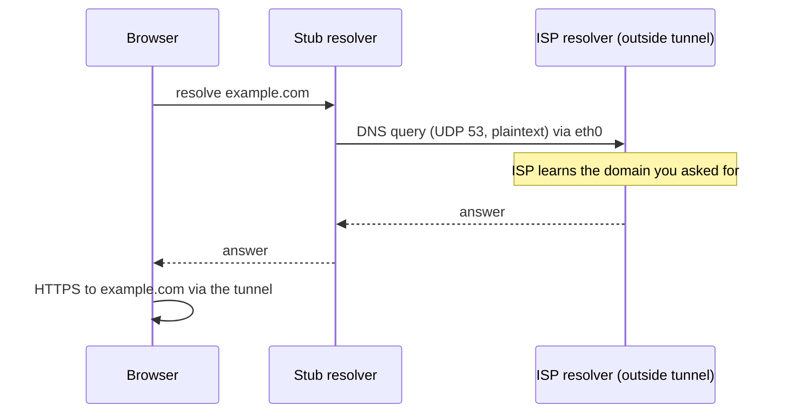
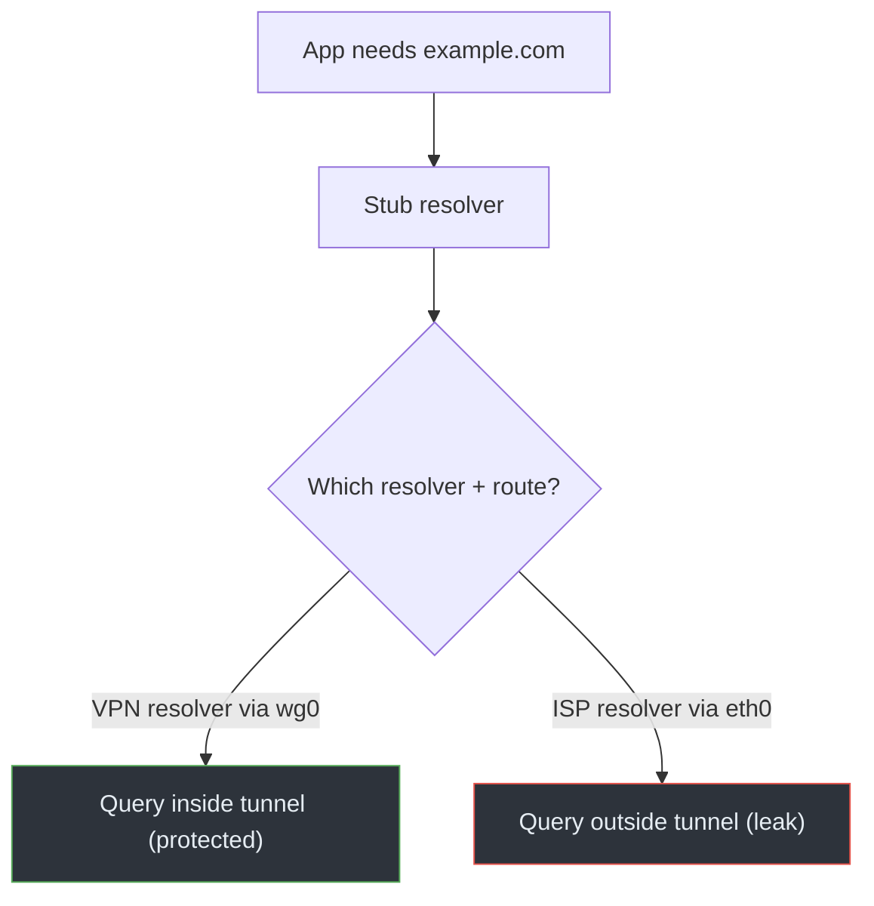

# 02 · DNS Leaks

## Overview

A DNS leak is when your name-resolution queries travel **outside the VPN
tunnel**, so an observer on the local network — or the resolver itself — learns
which domains you're visiting, even though the subsequent web connections are
tunneled. DNS is the most common leak because resolution is configured
separately from routing, and it's easy to tunnel the connection but forget the
lookup.

## Technical background

From [Module 01, DNS](../01-network-fundamentals/05-dns.md): your OS stub
resolver forwards queries to a recursive resolver, classically over plaintext
UDP/TCP port 53. Two things are independently configurable:

1. **Which resolver** the stub uses (`/etc/resolv.conf`, or per-link settings in
   `systemd-resolved`).
2. **Which path** packets to that resolver take (the routing table).

A VPN should set both: point the stub at a resolver it controls, and route that
resolver's traffic into the tunnel. If either is left alone, queries can escape.

> **CONCEPT**
> DNS privacy has two separate questions: *who answers* (which resolver operator
> learns your queries) and *what path the query takes* (who on the network can
> observe it). A "DNS leak" is primarily about the **path** leaving the tunnel.
> Using your ISP's resolver *through* the tunnel isn't a path leak, though it's
> still a trust choice.

## How it works

The classic failure: the VPN routes web traffic into `wg0` but leaves
`/etc/resolv.conf` pointing at the ISP resolver reachable via `eth0`. The browser
asks the stub, the stub forwards to the ISP resolver out the physical interface,
and the ISP sees the domain. Then the browser opens the actual HTTPS connection
through the tunnel. The content is hidden; the *fact you asked for that domain*
is not.

A subtler variant is **split DNS** with `systemd-resolved`: each interface can
have its own DNS servers and routing domains. If the physical interface keeps a
default-route DNS domain (`~.`) while the tunnel's resolver is only used for
specific domains, most queries still go to the physical interface's resolver.

## Packet / traffic flow

```text
Protected DNS:
  app -> stub -> resolver 10.8.0.1 via wg0 -> [tunnel] -> VPN resolver
  local observer sees: only encrypted tunnel traffic

Leaked DNS:
  app -> stub -> resolver 192.0.2.53 via eth0 -> ISP
  local observer sees: plaintext "example.com? A" on UDP/53
```

The Mermaid sequence version is in [`diagrams/dns-leak.mmd`](../../diagrams/dns-leak.mmd):



## Architecture diagram



## Root causes

- VPN client doesn't push/override DNS on connect.
- `systemd-resolved` split-DNS leaves a default DNS domain on the physical link.
- The resolver's IP isn't covered by the tunnel routes, so queries to it go out
  `eth0` even if it's "the VPN's" resolver.
- Applications that do their own DNS (browsers with built-in DoH, some apps)
  bypass the system resolver entirely.
- Reconnect windows where DNS reverts to the ISP before the tunnel is back.

## Practical scenario

You connect WireGuard with a config that has no `DNS =` line. `wg-quick` brings
the tunnel up and routes traffic, but `resolvectl status` still shows your ISP
resolver on `eth0`. Browsing works and an IP check shows the VPN address — yet
every domain you visit is visible to your ISP in plaintext DNS. Adding
`DNS = 10.8.0.1` (and ensuring that address routes through the tunnel) fixes it.

## Detection methods

> **IMPORTANT**
> Seeing a resolver's address in `dig` output is a **hint, not proof**. The
> resolver might be reached *through* the tunnel. To confirm a leak you must
> check the **path**, not just the address.

Combine two observations:

1. Which resolver is configured and answering:
   ```bash
   resolvectl status
   dig example.com          # read the SERVER: line
   ```
2. Whether DNS packets actually leave the physical interface:
   ```bash
   sudo tcpdump -ni eth0 'udp port 53 or tcp port 53'
   ```
   If you see your queries on `eth0` while the VPN is up, that's a path leak. If
   `eth0` shows only the tunnel's UDP stream and no port-53 traffic, DNS is
   staying inside.

This pairing is exactly [Lab 04](../07-practical-labs/lab-04-dns-leak.md).

> **TECHNICAL NOTE**
> If the system uses **DoH** (port 443) or **DoT** (port 853), there is no
> readable port-53 traffic to grep for. The query is encrypted, so detection
> shifts to: which resolver endpoint is being contacted, and does that
> connection route through the tunnel? Absence of port-53 packets does **not**
> prove DNS is private.

## Prevention techniques

- Set the VPN's resolver on connect (`DNS =` in WireGuard; pushed `dhcp-option
  DNS` in OpenVPN) and make sure it routes through the tunnel.
- With `systemd-resolved`, ensure the tunnel interface carries the default DNS
  domain (`~.`), or use `resolvectl domain wg0 '~.'` so queries prefer it.
- Block outbound port 53 (and 853) on the physical interface via the firewall as
  a backstop, forcing DNS through the tunnel.
- For browsers with built-in DoH, configure them to use the tunnel's resolver or
  disable the bypass.
- Re-check after reconnects; DNS is a common thing to revert during the gap.

## Common misconceptions

- *"No port-53 traffic means no DNS leak."* False with DoH/DoT — the DNS is just
  encrypted.
- *"The resolver address is my ISP's, so it's definitely leaking."* Not
  necessarily — verify the path. It could be reached through the tunnel.
- *"DNS leaks expose the pages I read."* They expose the *domains* you resolve,
  not full URLs or page content (HTTPS still protects those).
- *"The VPN encrypts DNS automatically."* Only if DNS is routed into the tunnel
  and/or encrypted; it's a configuration outcome, not a guarantee.

## References

- [RFC 1034](https://www.rfc-editor.org/rfc/rfc1034) /
  [RFC 1035 — DNS](https://www.rfc-editor.org/rfc/rfc1035)
- [RFC 8484 — DNS over HTTPS](https://www.rfc-editor.org/rfc/rfc8484)
- [RFC 7858 — DNS over TLS](https://www.rfc-editor.org/rfc/rfc7858)
- [RFC 7359 — VPN Traffic Leakage](https://www.rfc-editor.org/rfc/rfc7359)
- [`resolvectl(1)`](https://man7.org/linux/man-pages/man1/resolvectl.1.html),
  [`systemd-resolved.service(8)`](https://man7.org/linux/man-pages/man8/systemd-resolved.service.8.html)

---

Next: [03 · IPv6 Leaks](03-ipv6-leaks.md) · Back: [Module index](README.md)