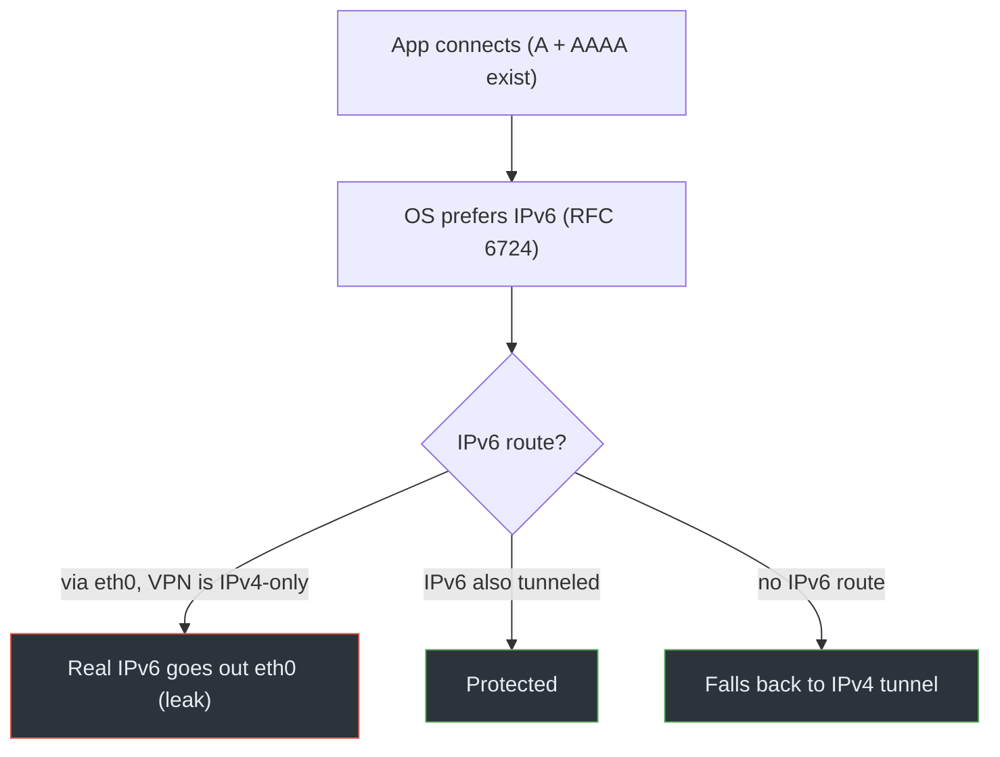
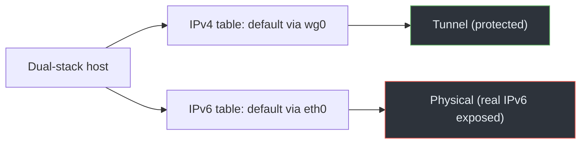

# 03 · IPv6 Leaks

## Overview

An IPv6 leak happens when a dual-stack host sends IPv6 traffic **around** a VPN
that only tunnels IPv4. Because IPv6 has its own routing table and the OS often
*prefers* IPv6, a connection can silently use your real, globally routable IPv6
address while you believe everything is going through the tunnel.

## Technical background

Two facts from Module 01 combine to create this leak:

1. **IPv4 and IPv6 are separate.** Different addresses, different routing tables
   (`ip route` vs `ip -6 route`). Installing IPv4 tunnel routes does nothing to
   IPv6.
2. **IPv6 is usually public.** Unlike IPv4 behind NAT, a host typically gets a
   globally routable IPv6 address directly from its ISP. So an IPv6 connection
   that bypasses the tunnel exposes an address that identifies your actual
   network — often more precisely than the shared IPv4 does.

When a name has both an `A` (IPv4) and an `AAAA` (IPv6) record, the OS address
selection ([RFC 6724](https://www.rfc-editor.org/rfc/rfc6724)) generally prefers
IPv6 if it appears to work. That preference is what routes the connection onto
the unprotected path.

> **CONCEPT**
> **Dual-stack** means running both families at once. It's normal and desirable
> — but it means there are *two* paths to the Internet, and a VPN must protect
> both. Protecting only IPv4 leaves a fully functional second path wide open.

## How it works

The VPN installs a full IPv4 tunnel (default via `wg0`) but adds no IPv6 routes.
The IPv6 default route still points out `eth0`. The browser resolves
`example.com`, gets both records, prefers IPv6, and connects to the `AAAA`
address via `eth0` using the host's real IPv6 source. The destination sees your
real IPv6 address. The IPv4 path is protected; the connection simply didn't use
it.

## Packet / traffic flow

```text
Dual-stack destination (A + AAAA):
  IPv4 path: app -> wg0 -> server -> dest        (protected)
  IPv6 path: app -> eth0 (src 2001:db8:1::10) -> dest   (LEAK, often preferred)
```

The full flowchart is [`diagrams/ipv6-leak.mmd`](../../diagrams/ipv6-leak.mmd):



## Architecture diagram



## Root causes

- VPN client tunnels IPv4 only and ignores IPv6 entirely.
- IPv6 default route remains on the physical interface.
- The VPN provider has no IPv6 support, so the client can't route it even if it
  wanted to.
- Address selection prefers IPv6, steering connections onto the unprotected path.

## Practical scenario

Your ISP gives you IPv6. You connect an IPv4-only VPN and visit a dual-stack
"what's my IP" site. It shows the VPN's IPv4 — but a separate IPv6 test (or the
same site's IPv6 result) shows your real `2001:db8:…` address. Any dual-stack
service you contact can see that IPv6 and correlate it with your real network.

## Detection methods

- Inspect the IPv6 routing table and predict a route:
  ```bash
  ip -6 route
  ip -6 route get 2001:db8:99::1
  ```
  If the result is `dev eth0` while the VPN is up, IPv6 leaks.
- Force an IPv6 connection to an echo service and compare the reported address:
  ```bash
  curl -6 https://example.test/ip     # use a real IPv6-capable echo service
  ```
- Capture IPv6 on the physical interface:
  ```bash
  sudo tcpdump -ni eth0 'ip6 and not icmp6'
  ```
  Non-tunnel IPv6 to public destinations while the VPN is up is a leak.

This is [Lab 05](../07-practical-labs/lab-05-ipv6-leak.md).

## Prevention techniques

There are two sound strategies — pick based on whether your VPN supports IPv6:

1. **Tunnel IPv6 too.** If the provider supports it, ensure `::/0` routes through
   the tunnel (WireGuard `AllowedIPs = ::/0` plus an IPv6 tunnel address). This
   keeps IPv6 working *and* private. Preferred when available.
2. **Block IPv6 outside the tunnel.** If the VPN has no IPv6, use firewall rules
   to drop IPv6 on the physical interface (or disable IPv6 for the connection),
   so traffic falls back to the protected IPv4 path.

> **IMPORTANT**
> Disabling IPv6 is **not** the universal or preferred fix. It's a fallback for
> when the VPN genuinely can't carry IPv6. Where the provider supports IPv6,
> tunneling it is better than turning it off. See
> [Module 08](../08-prevention/01-hardening-the-vpn.md) for the trade-offs.

## Common misconceptions

- *"My IP check shows the VPN, so IPv6 is fine."* Many checks are IPv4-only.
  Test IPv6 explicitly.
- *"I don't use IPv6, so it can't leak."* If your interface has a global IPv6
  address and a default route, the OS may use it without you asking.
- *"Disabling IPv6 is always the answer."* Only when the VPN can't tunnel it;
  otherwise tunnel it properly.
- *"IPv6 leaks are rare."* On dual-stack networks with IPv4-only VPNs they're
  common, because IPv6 is preferred by default.

## References

- [RFC 8200 — IPv6](https://www.rfc-editor.org/rfc/rfc8200)
- [RFC 6724 — Default Address Selection](https://www.rfc-editor.org/rfc/rfc6724)
- [RFC 7359 — VPN Traffic Leakage](https://www.rfc-editor.org/rfc/rfc7359)
- Linux man pages: [`ip-route(8)`](https://man7.org/linux/man-pages/man8/ip-route.8.html)

---

Next: [04 · WebRTC Leaks](04-webrtc-leaks.md) · Back: [Module index](README.md)