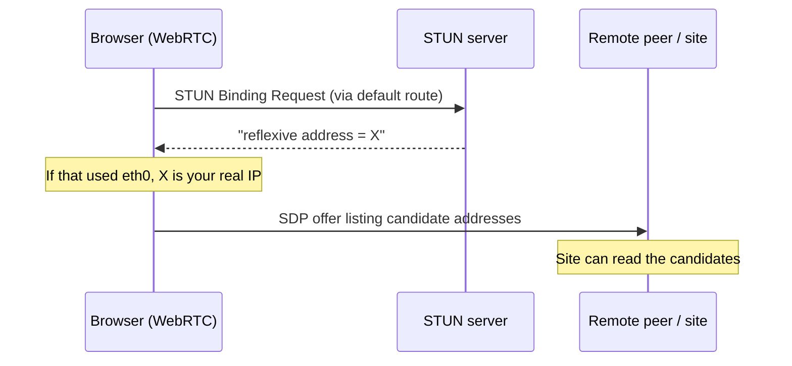
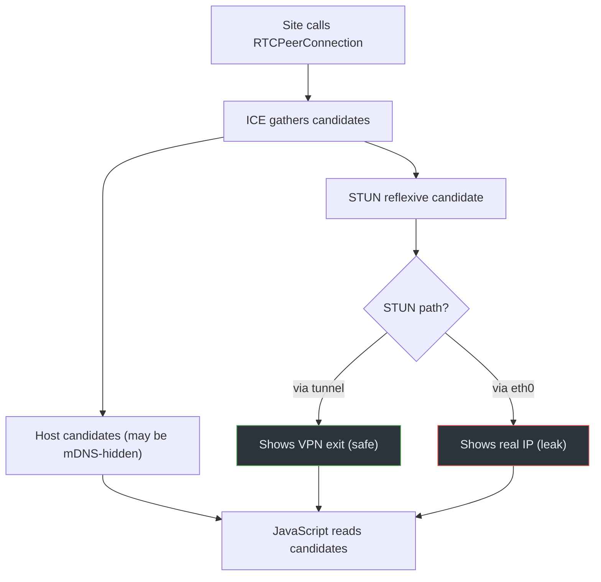

# 04 · WebRTC Leaks

## Overview

WebRTC is a browser API for real-time audio/video and peer-to-peer data. To
connect peers, it gathers a list of candidate addresses — which can include your
local and public IPs — and a website can read that list via JavaScript. Under
some browser configurations, this discloses an address the VPN was meant to
hide. Unlike the other leaks, this one is driven by **browser behavior**, not
just routing.

## Technical background

WebRTC uses **ICE** (Interactive Connectivity Establishment,
[RFC 8445](https://www.rfc-editor.org/rfc/rfc8445)) to find a working path between
peers. ICE gathers candidates of a few types:

- **Host candidates** — the machine's own interface addresses (often private).
- **Server-reflexive candidates** — the public address as seen by a **STUN**
  server ([RFC 5389](https://www.rfc-editor.org/rfc/rfc5389)). The browser asks a
  STUN server "what address do you see me from?" and gets back a public IP.
- **Relay candidates** — addresses on a TURN relay, used when direct paths fail.

A page creates an `RTCPeerConnection`, and as candidates are gathered they become
visible to the page's JavaScript (and thus to the site). The sequence is in
[`diagrams/webrtc-flow.mmd`](../../diagrams/webrtc-flow.mmd).

> **CONCEPT**
> The exposure is a *browser disclosure*: the site learns addresses because the
> browser hands them over as part of normal WebRTC operation. It's not the VPN
> "failing to encrypt" — it's the application layer volunteering information.

## How it works

Whether this actually leaks your real IP depends on several factors:

- If the STUN request goes out the **physical** interface (because WebRTC traffic
  isn't forced through the tunnel), the reflexive candidate is your real public
  IP, and the site sees it.
- If STUN goes through the tunnel, the reflexive candidate is the VPN exit — no
  leak of the real IP.
- Modern browsers increasingly hide **local** host candidates behind **mDNS**
  (`.local`) names, so private IPs are often no longer exposed. Public-IP
  exposure still depends on the STUN path and browser settings.

> **IMPORTANT**
> WebRTC exposure **depends on browser behavior and configuration** — browser
> vendor, version, settings, and whether a site is allowed to use WebRTC. It is
> not a universal, always-on leak, and it has been mitigated in many modern
> browsers. Treat "WebRTC always leaks your IP" as outdated.

## Packet / traffic flow



## Architecture diagram



## Root causes

- WebRTC/STUN traffic not routed through the tunnel.
- Browser settings that allow WebRTC to enumerate interfaces/candidates.
- A site actively probing candidates via JavaScript.
- Older browsers that still expose private host candidates directly.

## Practical scenario

You connect a VPN and load a page that runs a WebRTC probe. On an older or
permissively-configured browser, the page reports your real public IP as a
reflexive candidate even though your normal browsing shows the VPN address. On a
current browser with mDNS candidate hiding and the STUN path tunneled, the same
probe shows only the VPN exit or `.local` names.

## Detection methods

- Use a WebRTC test page (one you trust) and compare the reported candidates
  against your VPN exit and your real IP.
- Check whether STUN traffic leaves the physical interface:
  ```bash
  sudo tcpdump -ni eth0 'udp port 3478 or udp port 19302'
  ```
  (3478 is the common STUN port; Google's STUN also uses 19302.) Seeing STUN on
  `eth0` while the VPN is up suggests the reflexive candidate will be your real
  IP.
- Review browser settings for WebRTC/IP-handling policies.

## Prevention techniques

- Force all traffic (including WebRTC's STUN) through the tunnel with a proper
  full tunnel and kill switch, so the reflexive candidate is the VPN exit.
- Disable or restrict WebRTC in the browser if you don't need it (via settings
  or policy), understanding this may break video calls.
- Keep the browser current to benefit from mDNS candidate hiding.
- Use browser extensions or policies that limit candidate exposure, from
  reputable sources.

## Common misconceptions

- *"WebRTC always leaks my real IP."* Not on current browsers with mDNS hiding
  and a tunneled STUN path; it's configuration- and version-dependent.
- *"A VPN alone fixes WebRTC."* Only if WebRTC traffic is actually routed through
  the tunnel; otherwise the browser still discloses the reflexive address.
- *"WebRTC leaks expose my private IP on every browser."* Many modern browsers
  hide local candidates behind mDNS.
- *"This is a VPN encryption failure."* It's an application-layer disclosure,
  not a broken tunnel.

## References

- [RFC 8825 — WebRTC Overview](https://www.rfc-editor.org/rfc/rfc8825)
- [RFC 8445 — ICE](https://www.rfc-editor.org/rfc/rfc8445)
- [RFC 5389 — STUN](https://www.rfc-editor.org/rfc/rfc5389)
- [RFC 8828 — WebRTC IP Address Handling Requirements](https://www.rfc-editor.org/rfc/rfc8828)
  (the basis for mDNS candidate hiding in modern browsers)
- [RFC 7359 — VPN Traffic Leakage](https://www.rfc-editor.org/rfc/rfc7359)

---

Next: [05 · Routing Leaks](05-routing-leaks.md) · Back: [Module index](README.md)