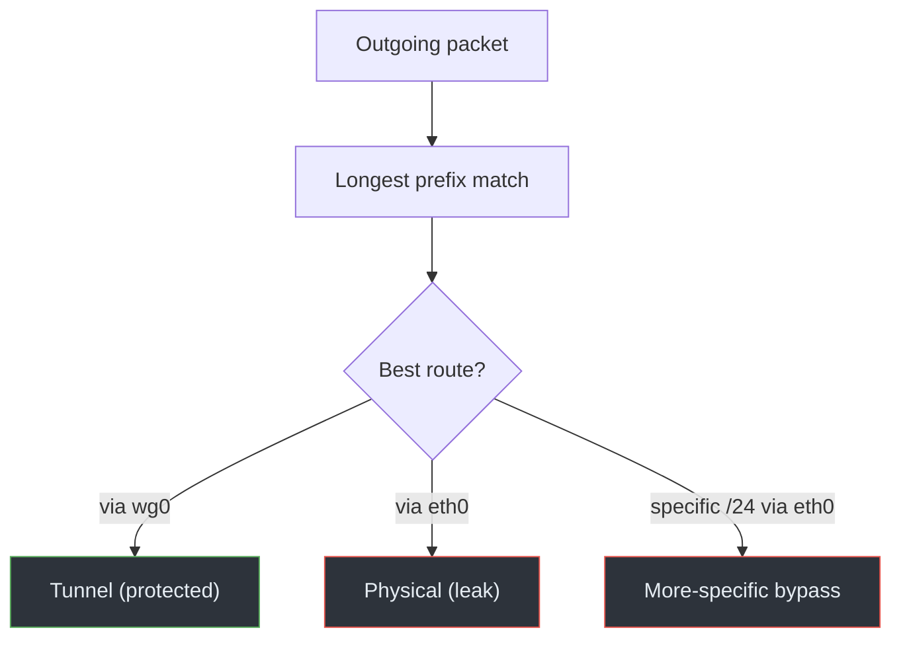

# 05 · Routing Leaks

## Overview

A routing leak is the general mechanism behind several of the other chapters:
the routing table sends a packet out the **physical interface** when it should
have gone into the tunnel. Public-IP and IPv6 leaks are specific cases; this
chapter looks at the routing decisions themselves — how routes are installed,
how they compete, and how they go wrong.

## Technical background

From [Module 01, routing](../01-network-fundamentals/04-routing.md): the kernel
picks a route by **longest prefix match**, breaking ties with **metric** (lower
wins). A full-tunnel VPN needs the tunnel to win for every destination. It
usually does this by either replacing the default route or adding the two
covering routes `0.0.0.0/1` and `128.0.0.0/1`, which are more specific than the
`/0` default.

Leaks appear when that coverage is incomplete or when something more specific
points the other way.

## How it works

Several distinct routing failures produce leaks:

- **Missing coverage.** The VPN adds routes for some prefixes but not all, so
  uncovered destinations use the old default out `eth0`.
- **A more-specific physical route.** If a route like `203.0.113.0/24 via eth0`
  exists (say, pushed by DHCP or a static config), it beats the tunnel's `/1` or
  default for that range, even in a "full tunnel."
- **Metric conflicts.** Two equally specific routes where the physical one has
  the lower metric wins.
- **Policy-routing surprises.** Rules (`ip rule`) may send certain traffic to a
  table that lacks tunnel routes.
- **Route churn on reconnect.** During teardown/reconnect the table briefly
  reverts to the physical default.

## Packet / traffic flow

```text
Destination 203.0.113.10, table contains:
  0.0.0.0/1 via wg0        (tunnel covering route)
  128.0.0.0/1 via wg0      (tunnel covering route)
  203.0.113.0/24 via eth0  (more-specific physical route)

Longest prefix match -> /24 wins -> packet goes out eth0 -> LEAK
```

The `/24` is more specific than the `/1`s, so it wins even though the tunnel
"covers everything." Specificity beats intent.

## Architecture diagram

The decision flow is [`diagrams/routing-flow.mmd`](../../diagrams/routing-flow.mmd):



## Root causes

- Incomplete route installation by the client.
- Pre-existing specific routes (DHCP classless routes, static routes) that
  override the tunnel.
- Lower-metric physical routes.
- Policy-routing rules pointing at tables without tunnel routes.
- Reconnect windows where routes revert.

## Practical scenario

A corporate laptop has a DHCP-pushed route for a public range via the local
gateway. The user connects a full-tunnel VPN. Most traffic goes through the
tunnel, but traffic to that one range still uses the physical route because the
`/24` is more specific than the tunnel's covering `/1`s. The user sees the VPN
"connected" and an IP check passing, while that range leaks. `ip route get` for
an address in the range reveals the physical path immediately.

## Detection methods

- Predict routes for a spread of destinations, not just one:
  ```bash
  ip route get 203.0.113.10
  ip route get 198.51.100.5
  ip -6 route get 2001:db8:99::1
  ```
- Dump the whole table and look for any non-tunnel route more specific than the
  tunnel's coverage:
  ```bash
  ip route show table all
  ip rule
  ```
- Compare tables before and after connecting to spot what the client changed.

This is [Lab 03](../07-practical-labs/lab-03-routing-investigation.md).

## Prevention techniques

- Use a client that installs complete coverage (default via tunnel, or both
  `/1`s) for both families.
- Audit for more-specific physical routes that could override the tunnel; remove
  or override them if they're not intentional.
- Verify with `ip route get` across several destinations after connecting.
- Pair routing with a kill switch so that even a routing gap during reconnect
  can't leak (see [chapter 07](07-kill-switch-failures.md)).

## Common misconceptions

- *"The default route points at the tunnel, so everything is covered."* A
  more-specific route elsewhere can still override it for some destinations.
- *"Full tunnel means no routing leaks."* Only if coverage is truly complete and
  nothing more specific points the other way.
- *"Routing leaks and public-IP leaks are different problems."* A routing leak
  is usually the *cause*; a public-IP leak is the *symptom*.

## References

- Linux man pages: [`ip-route(8)`](https://man7.org/linux/man-pages/man8/ip-route.8.html),
  [`ip-rule(8)`](https://man7.org/linux/man-pages/man8/ip-rule.8.html)
- [RFC 1812 — IPv4 Router Requirements](https://www.rfc-editor.org/rfc/rfc1812)
- [RFC 7359 — VPN Traffic Leakage](https://www.rfc-editor.org/rfc/rfc7359)

---

Next: [06 · Split Tunneling Risks](06-split-tunneling-risks.md) ·
Back: [Module index](README.md)