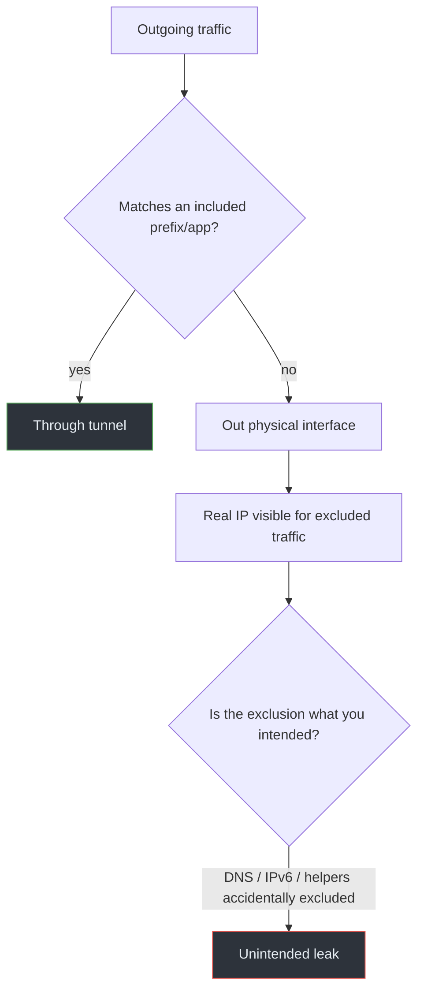

# 06 · Split Tunneling Risks

## Overview

Split tunneling routes *some* traffic through the VPN and lets the rest go out
the physical interface directly. It's a legitimate, often useful design — but
every excluded destination is a deliberate bypass. The risk is when the
exclusion is **broader than the user realizes**, or when it quietly includes
things like DNS or an entire address family.

## Technical background

A split tunnel is expressed in the routing table (and sometimes policy routing)
as a set of specific prefixes via the tunnel, with the normal default route
still on the physical interface. Only destinations matching the tunnel prefixes
are protected; everything else uses the physical path.

Clients implement split tunneling in a few ways:

- **Route-based:** only certain subnets get tunnel routes (common in corporate
  VPNs — only company networks go through).
- **App-based:** the client forces specific applications into the tunnel and
  leaves others out (or vice versa).
- **Domain/destination-based:** the user lists sites or ranges to include or
  exclude.

## How it works

The danger isn't split tunneling itself — it's the gap between *what the user
thinks is excluded* and *what actually is*. Examples:

- A user excludes "just my banking site" but the client's exclusion also covers
  the DNS resolver, so all DNS leaks.
- An "exclude local network" option is implemented as a broad route that also
  excludes more than the LAN.
- App-based split tunneling misses a helper process or a browser's WebRTC/STUN
  traffic, which goes out the physical path.
- IPv6 is left entirely outside the split, so all IPv6 bypasses.

## Packet / traffic flow

```text
Split tunnel: 10.0.0.0/8 via wg0 (company net), default via eth0

  to 10.20.30.40   -> wg0 -> protected
  to 203.0.113.10  -> eth0 -> real IP (intentional bypass)
  DNS to resolver  -> eth0 -> leak (if not explicitly included)
```

## Architecture diagram



## Root causes

- Exclusion lists broader than intended.
- DNS not explicitly included in the tunnel.
- IPv6 not handled by the split policy.
- App-based rules missing helper/child processes.
- Default-include vs default-exclude confusion (which side is the default?).

## Practical scenario

A remote worker uses a corporate split tunnel that routes only `10.0.0.0/8`
through the VPN. They assume "the VPN is on" protects their browsing. In fact,
all public Internet traffic — and DNS — goes out their home connection with
their real IP. The split tunnel is working exactly as configured; the user's
mental model is what's wrong.

## Detection methods

- Read the routing table to see exactly what's included:
  ```bash
  ip route
  ip rule
  ```
  If the default route is still on the physical interface, it's a split tunnel.
- Test representative destinations:
  ```bash
  ip route get 10.20.30.40      # should be wg0
  ip route get 203.0.113.10     # will be eth0 in a split tunnel
  ```
- Check where DNS goes (see [DNS leaks](02-dns-leaks.md)) — it's the most common
  accidental exclusion.

## Prevention techniques

- Prefer a **full tunnel** when privacy is the goal; use split tunneling only
  when you have a concrete reason (local devices, latency-sensitive apps).
- Make exclusions as narrow as possible and review them explicitly.
- Always include DNS in the tunnel, even in a split configuration.
- Handle IPv6 deliberately — either tunnel it or block it outside the tunnel.
- Document what is excluded so the mental model matches reality.

## Common misconceptions

- *"Split tunneling is a bug."* It's a feature; the risk is mis-scoped
  exclusions and mistaken assumptions.
- *"The VPN is connected, so I'm protected."* In a split tunnel, only the
  included traffic is protected.
- *"Excluding one site excludes only that site."* Implementation details (DNS,
  helper processes, broad routes) can widen the bypass.

## References

- [RFC 7359 — VPN Traffic Leakage](https://www.rfc-editor.org/rfc/rfc7359)
- Linux man pages: [`ip-route(8)`](https://man7.org/linux/man-pages/man8/ip-route.8.html),
  [`ip-rule(8)`](https://man7.org/linux/man-pages/man8/ip-rule.8.html)
- [WireGuard quick-start (AllowedIPs / routing)](https://www.wireguard.com/quickstart/)

---

Next: [07 · Kill Switch Failures](07-kill-switch-failures.md) ·
Back: [Module index](README.md)