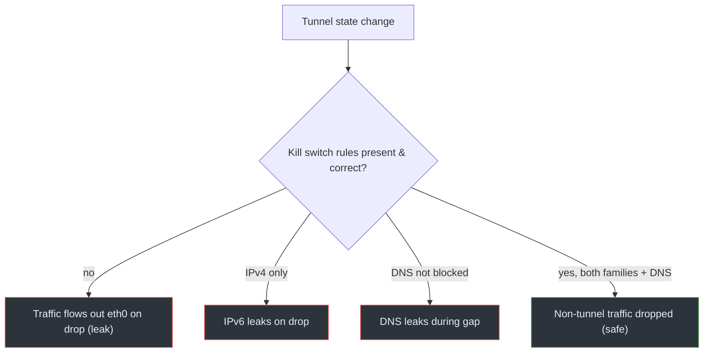

# 07 · Kill Switch Failures

## Overview

A kill switch is a firewall policy that blocks traffic whenever the VPN tunnel
is down, closing the leak windows described in
[Module 02's lifecycle chapter](../02-vpn-fundamentals/05-connection-lifecycle.md).
A kill-switch *failure* is when that protection is absent, incomplete, or
mis-timed — so the moment the tunnel drops, traffic flows in the clear with your
real IP.

## Technical background

From [Module 01, packet flow](../01-network-fundamentals/06-nat-and-packet-flow.md),
Linux filters packets with **Netfilter** hooks, configured via `nftables` (or
legacy `iptables`). A kill switch installs rules that:

- **Allow** the tunnel's own encapsulated traffic to the VPN server (so the
  tunnel can re-establish).
- **Allow** traffic that goes *into* the tunnel interface.
- **Drop** everything else leaving the physical interface.

With those rules, even if routing reverts to the physical default during a
disconnect, the firewall drops the packets instead of leaking them.

> **CONCEPT**
> Routing decides *where* a packet wants to go; the firewall decides *whether
> it's allowed to*. A kill switch works at the firewall layer, so it protects
> even when routing is momentarily wrong. That's why it's the backstop for the
> other leak classes.

## How it works (and fails)

A correct kill switch drops non-tunnel traffic regardless of tunnel state. It
fails in several ways:

- **Absent:** no firewall rules at all; a dropped tunnel immediately leaks.
- **IPv4-only:** rules cover IPv4 but not IPv6, so IPv6 leaks on disconnect.
- **DNS not covered:** port-53 (or DoH/DoT) to the physical resolver isn't
  blocked, so DNS leaks during the gap even if other traffic is dropped.
- **Race on reconnect:** rules are removed before the tunnel is fully back, or
  re-added too late, leaving a window.
- **Per-app instead of system-wide:** only some apps are blocked; others leak.
- **Allow rule too broad:** the "allow traffic to the VPN server" rule
  accidentally permits more than the tunnel endpoint.

## Packet / traffic flow

```text
Tunnel drops:
  Without kill switch:
    app -> eth0 (default route back) -> real IP exposed  (LEAK)

  With correct kill switch:
    app -> eth0 -> nftables OUTPUT/FORWARD drop -> no leak
    (only encapsulated traffic to VPN server is allowed, to reconnect)
```

## Architecture diagram



## Root causes

- No kill switch implemented by the client.
- Rules cover only one address family.
- DNS traffic not explicitly blocked on the physical interface.
- Timing gaps between tunnel teardown and rule (re)application.
- Overly permissive allow rules.

## Practical scenario

You're on a full-tunnel VPN with no kill switch. The server reboots. For the two
seconds before the client reconnects, your OS reverts to the physical default
route and a background sync uploads data with your real IP. A packet capture on
`eth0` during that window shows plaintext-destination traffic that should never
have left. [Lab 07](../07-practical-labs/lab-07-kill-switch.md) reproduces this
safely by bringing the tunnel down on purpose.

## Detection methods

- Inspect the firewall ruleset and confirm it drops non-tunnel egress on the
  physical interface for **both** families:
  ```bash
  sudo nft list ruleset
  ```
- Deliberately drop the tunnel in a controlled lab and watch the physical
  interface:
  ```bash
  sudo tcpdump -ni eth0 'not udp port 51820'
  ```
  With a working kill switch you should see (almost) nothing; without one you'll
  see traffic leak.
- Check that DNS to non-tunnel resolvers is blocked during the gap.

## Prevention techniques

- Use a client with a system-wide kill switch, or implement one with `nftables`
  (see the [sample ruleset](../../labs/configs/) and
  [Module 08](../08-prevention/01-hardening-the-vpn.md)).
- Cover **both** IPv4 and IPv6.
- Explicitly block DNS (53, 853, and DoH endpoints) outside the tunnel.
- Keep the "allow VPN server" rule as narrow as possible (specific IP + port).
- Test the disconnect case, not just the connected case — that's where kill
  switches fail.

## Common misconceptions

- *"The VPN reconnects fast, so I don't need a kill switch."* Even a short gap
  leaks; speed isn't protection.
- *"A kill switch for IPv4 is enough."* IPv6 needs its own rules.
- *"Kill switch and full tunnel are the same thing."* A full tunnel is routing;
  a kill switch is a firewall backstop for when routing fails. You want both.
- *"If the kill switch is on, DNS can't leak."* Only if DNS is explicitly covered
  by the rules.

## References

- Linux man pages: [`nft(8)`](https://man7.org/linux/man-pages/man8/nft.8.html)
- [nftables wiki](https://wiki.nftables.org/)
- [RFC 7359 — VPN Traffic Leakage](https://www.rfc-editor.org/rfc/rfc7359)
- [WireGuard quick-start](https://www.wireguard.com/quickstart/)

---

Next: [Module 04 · Malicious VPN Applications](../04-malicious-vpns/README.md) ·
Back: [Module index](README.md)