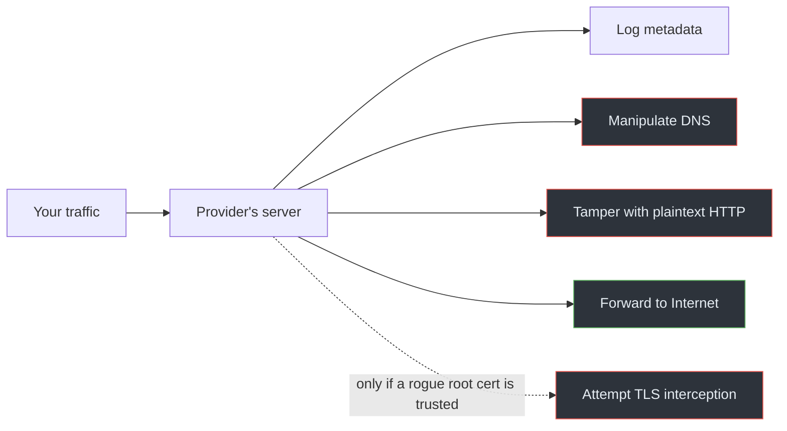

# 02 · Traffic Manipulation

## Overview

A VPN server doesn't just observe traffic — it *forwards* it, which means a
malicious operator can also *modify* it. This chapter covers what can be
tampered with, what can't, and the specific (and limited) conditions under which
HTTPS can be intercepted.

## The data-flow picture

[`diagrams/malicious-vpn.mmd`](../../diagrams/malicious-vpn.mmd) shows the
opportunities a malicious provider has:



## DNS manipulation

If the provider runs your resolver, it can:

- **Redirect** a name to an address it controls (phishing, ad injection).
- **Block** names (censorship) or **inject** answers.
- **Log** every domain you resolve.

This is effective because DNS answers are trusted by the OS. It's also
detectable: compare answers from the VPN resolver against a known-good resolver
you trust, and watch for unexpected addresses. DoH/DoT to an independent
resolver reduces this, but only if that resolver traffic itself goes somewhere
you trust.

## HTTP manipulation

For **unencrypted HTTP**, the provider is a full man-in-the-middle: it can read
and rewrite bodies, inject scripts or ads, and steal anything sent in the clear.
This is a strong argument for HTTPS everywhere — against a malicious VPN, plain
HTTP offers no protection at all.

## TLS interception and root certificate abuse

Here's the crucial limit.

> **IMPORTANT**
> A VPN provider **cannot silently decrypt correct HTTPS.** TLS authenticates
> the destination server via a certificate chain rooted in a trusted CA. To
> intercept it, the attacker must present a certificate the client trusts for
> that hostname — which requires the device to trust an **attacker-controlled
> root certificate**. Installing such a root is a deliberate, user-visible step
> (a profile, a prompt, an MDM policy), not something a VPN can do invisibly.

If a malicious client *does* get a rogue root certificate installed (through
social engineering, bundled "security" software, or enterprise management), it
can then issue valid-looking certificates for any site and perform real TLS
interception. That's why:

- You should never install a root certificate from a VPN or " cleaner" app
  without a very good, understood reason.
- Certificate transparency and browser pinning make large-scale silent
  interception harder to hide.

Without a trusted rogue root, attempted interception produces certificate
errors — visible to the user, not silent.

## What an attacker can and cannot see with correct HTTPS

| Visible to the provider | Not visible (with correct TLS) |
|-------------------------|--------------------------------|
| Destination IP / hostname (SNI, unless ECH) | Full URL path and query |
| Timing, volume, connection metadata | Request/response bodies |
| DNS queries (if it runs the resolver) | Cookies, credentials, page content |
| That a TLS connection occurred | The encrypted payload |

So the realistic threat is **metadata + DNS + plaintext HTTP**, plus TLS
interception *only if* a rogue root is trusted. Claims that a VPN "sees
everything you do in HTTPS" are exaggerated.

## Detection and mitigation

- Prefer HTTPS; treat any plain-HTTP site as fully exposed to the provider.
- Audit installed root certificates; remove ones you didn't intentionally add:
  ```bash
  ls /usr/local/share/ca-certificates/      # Debian: locally added roots
  ```
- Compare DNS answers across resolvers to spot redirection.
- Be skeptical of apps that ask to install certificates or profiles.

## References

- [RFC 8446 — TLS 1.3](https://www.rfc-editor.org/rfc/rfc8446)
- [RFC 6125 — Representation and Verification of Domain-Based Application Service Identity within PKI](https://www.rfc-editor.org/rfc/rfc6125)
- [RFC 8484 — DNS over HTTPS](https://www.rfc-editor.org/rfc/rfc8484)
- Linux: `update-ca-certificates` / [`ca-certificates` package docs](https://manpages.debian.org/update-ca-certificates)

---

Next: [03 · Clients & Supply Chain](03-clients-and-supply-chain.md) ·
Back: [Module index](README.md)