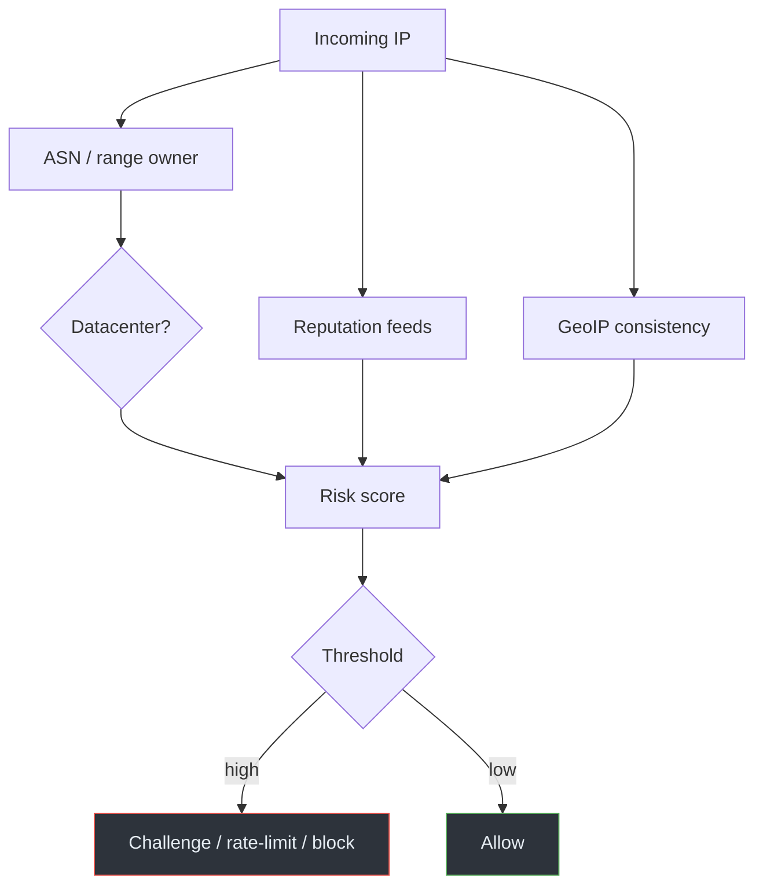

# 01 · Network-Based Detection

## Overview

The simplest way a platform guesses "this visitor is on a VPN" is to look at the
**IP address** they arrive from and ask: what kind of network owns this address?
This chapter covers the data sources behind that judgment — ASN ownership,
datacenter vs residential classification, IP reputation, and geolocation — and
why each is imperfect.

## Background: who owns an IP address?

The public IP space is allocated to organizations in blocks. Each organization
that routes its own blocks on the Internet is an **Autonomous System (AS)**,
identified by an **ASN** (Autonomous System Number). The mapping from an IP to
its originating ASN and owner is public, published via BGP routing data and
registration records (RDAP/WHOIS).

You can look this up yourself:

```bash
whois 198.51.100.5            # registration / ownership data
# or query a routing API / RDAP for the originating ASN
```

> **CONCEPT**
> An **ASN** tells you *who announces a prefix to the global routing table*.
> A hosting company, a university, a mobile carrier, and a home ISP each have
> distinct ASNs. That ownership is the raw signal behind "datacenter vs
> residential" classification.

## Datacenter vs residential

Classification services bucket IP ranges by the type of organization that owns
them:

| Network type | Typical owner | Typical interpretation |
|--------------|---------------|------------------------|
| Residential ISP | Consumer broadband provider | Likely a home user |
| Mobile carrier | Cellular operator | Likely a phone / hotspot |
| Datacenter / hosting | Cloud or hosting company | Likely a server, VPN exit, or proxy |
| Education / research | University network | Campus user |
| Business / corporate | Company netblock | Office user |

A **VPN exit** almost always lives in a **datacenter** range, because providers
rent servers. So "source IP belongs to a hosting ASN" is a strong (but not
conclusive) VPN signal.

> **IMPORTANT**
> A datacenter IP is **not** evidence of malice. Plenty of legitimate traffic
> comes from datacenters: cloud apps, APIs, corporate egress, CI systems. And
> some VPNs deliberately use residential-style exits. Classification is a
> probability, not a verdict.

## Shared VPN exit addresses

Many users share one VPN exit IP. That creates a distinctive pattern: a single
address generating traffic for many unrelated accounts, sessions, and
geographies. Platforms notice this concentration. It's a detection signal, but
it also causes **false positives** — everyone behind that exit inherits the
reputation of the worst actor using it.

## IP reputation

Reputation feeds aggregate signals about an address over time:

- Known VPN/proxy exit lists (maintained by providers and third parties).
- History of abuse, spam, or automated traffic from the address.
- Whether the address appears in threat-intelligence blocklists.

A platform checks the incoming IP against these feeds and adjusts its risk
score. Reputation is dynamic: a clean residential IP can become "suspicious" if
it's briefly used as a proxy, and a datacenter IP can be clean.

## GeoIP and location consistency

**GeoIP** databases map IP ranges to approximate geographic locations. Platforms
compare the IP's location against other signals (account's usual location,
billing address, language, timezone). A sudden mismatch — an account that always
logs in from one country appearing from a datacenter in another — raises a flag.

GeoIP is approximate and sometimes wrong, especially for mobile and anycast
ranges, so it's one input among many, not proof.

## Putting it together

The pipeline (see [`diagrams/vpn-detection.mmd`](../../diagrams/vpn-detection.mmd)):



## Limitations and false positives

- Datacenter ≠ malicious; many legitimate services run there.
- Residential ≠ trustworthy; compromised home devices act as proxies.
- Shared exits punish all users for one bad actor.
- GeoIP is approximate and stale.
- Reputation feeds lag and contain errors.

The takeaway: network-based detection is a useful *signal*, not a reliable
*identifier*. Platforms combine it with behavioral signals (next chapter) and
accept a nonzero false-positive rate.

## References

- [RFC 4271 — BGP-4](https://www.rfc-editor.org/rfc/rfc4271) (how prefixes and
  ASNs are announced on the Internet)
- [RFC 3912 — WHOIS Protocol](https://www.rfc-editor.org/rfc/rfc3912) (the
  registration lookup behind IP ownership)
- [RFC 7480 — HTTP Usage in RDAP](https://www.rfc-editor.org/rfc/rfc7480) (the
  modern, structured successor to WHOIS)

---

Next: [02 · Behavioral Detection](02-behavioral-detection.md) ·
Back: [Module index](README.md)