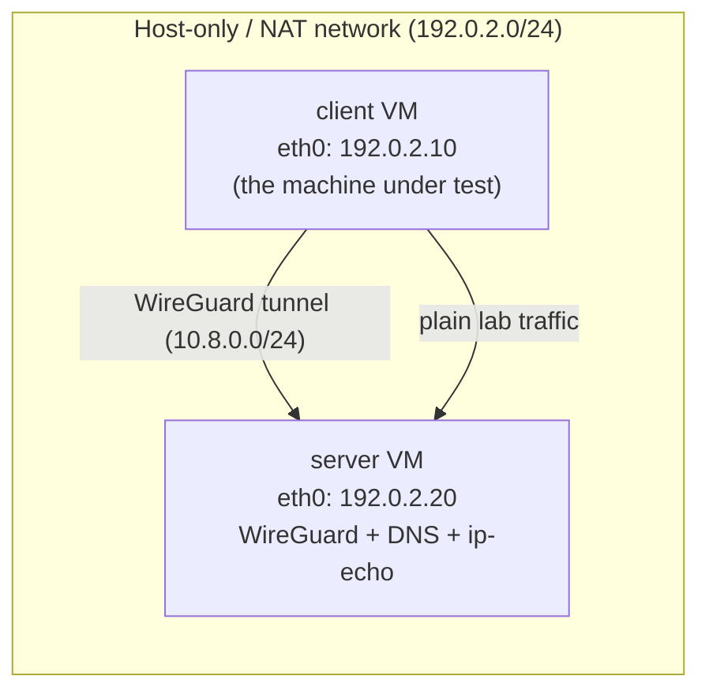

# Module 07 · Practical Labs

Seven reproducible labs that turn the earlier theory into things you can observe.
Each lab follows the same checklist so you always know what you need, what to
do, what to expect, and how to clean up.

| Lab | Focus | Builds on |
|-----|-------|-----------|
| [01 · Basic Network Inspection](lab-01-network-inspection.md) | Read your own network state | Module 01 |
| [02 · VPN Interface Analysis](lab-02-vpn-interface-analysis.md) | Bring up WireGuard, inspect the tunnel | Module 02 |
| [03 · Routing Table Investigation](lab-03-routing-investigation.md) | Predict and verify routes | Module 01/03 |
| [04 · DNS Leak Investigation](lab-04-dns-leak.md) | Prove where DNS goes | Module 03 |
| [05 · IPv6 Leak Investigation](lab-05-ipv6-leak.md) | Prove where IPv6 goes | Module 03 |
| [06 · Wireshark & tcpdump Analysis](lab-06-traffic-analysis.md) | Capture before/after | Module 06 |
| [07 · Kill Switch Testing](lab-07-kill-switch.md) | Test the disconnect case | Module 03 |

## Lab checklist (every lab has these)

1. Objective
2. Required knowledge
3. Required tools
4. Lab topology
5. Environment setup
6. Step-by-step instructions
7. Commands
8. Expected observations
9. Actual results **or clearly labeled illustrative output**
10. Technical explanation
11. Troubleshooting
12. Cleanup instructions
13. Learning outcomes

> **IMPORTANT**
> Outputs in these labs are **illustrative** unless a section explicitly says
> "captured." They use documentation addresses and will differ from your
> results. Never treat an illustrative block as a measurement. Run the lab to
> get your own data.

## Shared environment

All labs assume **two Debian-based VMs** you control. Using VMs (rather than your
daily machine) keeps experiments safe and repeatable.



- **client** — the machine you inspect and connect from. Interface `eth0`,
  address `192.0.2.10/24`.
- **server** — runs the WireGuard endpoint (`10.8.0.1`), a DNS resolver, and a
  tiny [IP-echo service](../../labs/scripts/ip-echo.py) so you can test "what
  source IP does the destination see?" without any third-party service.

> **TECHNICAL NOTE**
> Interface names vary (`eth0`, `enp0s3`, `ens160`…). Substitute your own. The
> labs use `eth0` for readability. Check with `ip -brief link`.

### Base setup (both VMs)

```bash
sudo apt update
sudo apt install -y iproute2 dnsutils tcpdump curl wireguard nftables python3
# Wireshark is only needed on the client for Lab 06:
sudo apt install -y wireshark    # client only
```

### Address plan (documentation ranges)

| Role | IPv4 | Tunnel IPv4 |
|------|------|-------------|
| client `eth0` | `192.0.2.10/24` | `10.8.0.2/32` |
| server `eth0` | `192.0.2.20/24` | `10.8.0.1/24` |
| gateway | `192.0.2.1` | — |

These are [RFC 5737](https://www.rfc-editor.org/rfc/rfc5737) example addresses.
In a real VM network you'll use whatever your hypervisor assigns (often
`192.168.x.x`); substitute consistently.

### Safety rules

- Run labs only on VMs/networks you control.
- Commands needing root are marked with `sudo` and called out in each lab.
- Nothing here attacks third-party services or intercepts others' traffic.
- Each lab ends with cleanup so you can return the VM to a known state.

## Supporting files

- [`labs/scripts/`](../../labs/scripts/) — small, readable helpers (inspection,
  route checks, DNS check, capture summary, IP echo).
- [`labs/configs/`](../../labs/configs/) — placeholder WireGuard configs and a
  kill-switch ruleset. **No real keys.**
- [`labs/sample-captures/`](../../labs/sample-captures/) — synthetic, labeled
  example outputs.

When you're done, continue to
[Module 08 · Prevention & Best Practices](../08-prevention/README.md).