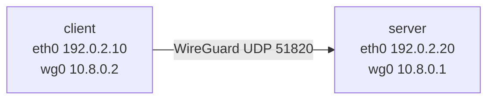

# Lab 02 · VPN Interface Analysis

## 1. Objective

Stand up a real WireGuard tunnel between two VMs, then inspect the virtual
interface, addresses, routes, and peer state it creates. This is the foundation
for every later lab.

## 2. Required knowledge

- [Module 02](../02-vpn-fundamentals/README.md): tunneling, WireGuard, lifecycle.
- [Lab 01](lab-01-network-inspection.md): reading interface/route state.

## 3. Required tools

`wireguard` (`wg`, `wg-quick`), `ip`, `ping`, `curl`. Config templates:
[`wg-client.conf`](../../labs/configs/wg-client.conf),
[`wg-server.conf`](../../labs/configs/wg-server.conf).

## 4. Lab topology



Both VMs on the same lab network; the tunnel is a second, virtual link on top.

## 5. Environment setup

On **both** VMs:

```bash
sudo apt update && sudo apt install -y wireguard iproute2 curl
```

Generate a key pair on **each** VM (private key never leaves that machine):

```bash
umask 077
wg genkey | tee privatekey | wg pubkey > publickey
cat publickey        # share THIS with the other VM
```

Exchange public keys: the client's `publickey` goes into the server's `[Peer]`,
and the server's `publickey` goes into the client's `[Peer]`.

## 6–7. Steps and commands

**Server** — copy `wg-server.conf`, fill in `<SERVER_PRIVATE_KEY>` (its own
private key) and `<CLIENT_PUBLIC_KEY>` (the client's public key), then:

```bash
sudo sysctl -w net.ipv4.ip_forward=1
sudo wg-quick up ./wg-server.conf
sudo wg show
```

**Client** — copy `wg-client.conf`, fill in `<CLIENT_PRIVATE_KEY>` and
`<SERVER_PUBLIC_KEY>`, then:

```bash
sudo wg-quick up ./wg-client.conf
ip -brief addr            # a new wg0 interface should appear
ip route                  # default (or /1s) should now point at wg0
sudo wg show              # peer, endpoint, latest handshake, transfer
```

**Verify the tunnel carries traffic:**

```bash
ping -c 3 10.8.0.1                       # reach the server's tunnel address
curl -4 http://192.0.2.20:8080/          # if ip-echo.py runs on the server
```

(Start the echo service on the server with
`python3 labs/scripts/ip-echo.py` — it reports the source IP it sees.)

## 8. Expected observations

- `ip -brief addr` shows `wg0` with `10.8.0.2/32` on the client.
- `ip route` shows the default (or `0.0.0.0/1` + `128.0.0.0/1`) via `wg0`.
- `wg show` shows a peer with `allowed ips: 0.0.0.0/0, ::/0`, a recent
  `latest handshake`, and nonzero `transfer`.
- `ping 10.8.0.1` succeeds.
- The echo service reports the **server's** view of your source (the tunnel /
  server address), not `192.0.2.10`.

## 9. Illustrative output

> **ILLUSTRATIVE** — not a real capture. Keys shown as placeholders.

```text
$ ip -brief addr
lo      UNKNOWN   127.0.0.1/8 ::1/128
eth0    UP        192.0.2.10/24
wg0     UNKNOWN   10.8.0.2/32

$ sudo wg show
interface: wg0
  public key: <CLIENT_PUBLIC_KEY>
  private key: (hidden)
peer: <SERVER_PUBLIC_KEY>
  endpoint: 192.0.2.20:51820
  allowed ips: 0.0.0.0/0, ::/0
  latest handshake: 8 seconds ago
  transfer: 1.20 KiB received, 980 B sent
```

## 10. Technical explanation

`wg-quick` creates the `wg0` interface, assigns the inner address, installs
routes from `AllowedIPs`, and sets DNS. The handshake authenticates the peers by
public key; subsequent packets are encrypted UDP to the endpoint. The routing
change is what moves traffic into the tunnel — the cryptography protects it once
it's there.

## 11. Troubleshooting

- **No handshake** — check the endpoint address/port and that both public keys
  are swapped correctly; confirm UDP 51820 isn't firewalled between the VMs.
- **`wg-quick: command not found`** — install the `wireguard-tools` package.
- **Handshake OK, no traffic** — verify `AllowedIPs` and that the server enables
  forwarding + NAT (see the server config's PostUp).
- **Permission denied on keys** — private key files must be mode 600 (`umask 077`).

## 12. Cleanup

```bash
sudo wg-quick down ./wg-client.conf     # on the client
sudo wg-quick down ./wg-server.conf     # on the server
rm -f privatekey publickey              # remove generated lab keys
```

Confirm `ip -brief addr` no longer shows `wg0` and `ip route` is back to normal.

## 13. Learning outcomes

You can generate WireGuard keys, bring a tunnel up and down, identify the tunnel
interface and its routes, and confirm the tunnel actually passes traffic.

---

Next: [Lab 03 · Routing Table Investigation](lab-03-routing-investigation.md) ·
Back: [Lab index](README.md)