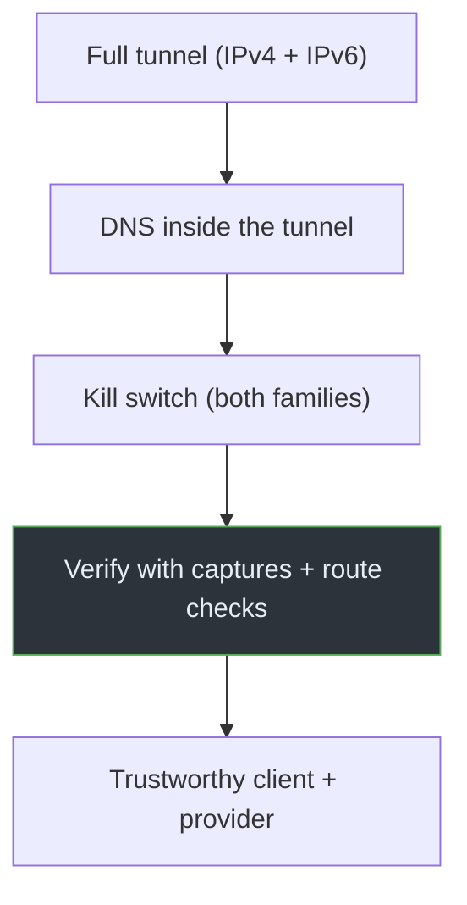

# Module 08 · Prevention & Security Best Practices

The earlier modules explained how things break. This one puts the fixes
together into a practical hardening approach — with the trade-offs stated
honestly, because every protection has limits.

| Chapter | Topic |
|---------|-------|
| [01 · Hardening the VPN](01-hardening-the-vpn.md) | Config, DNS, IPv6, kill switch, routing, firewall |
| [02 · Trust & Verification](02-trust-and-verification.md) | Client trust, authenticity, installation, policies, checklist |

## The layered approach

No single setting makes a VPN safe. Defense comes from layers that cover each
other's gaps:

Routing (A) is the first line; DNS (B) closes the most common leak; the kill
switch (C) covers the moments routing fails; verification (D) proves it actually
works; and trust (E) addresses what the provider itself can see.

> **IMPORTANT**
> Each layer has limits. A full tunnel doesn't cover a reconnect gap; a kill
> switch doesn't help if the provider logs everything; verification only proves
> the moment you tested. The goal is to stack layers so no single failure
> exposes you, and to know what each one does *not* do.

Prerequisites: the whole project, especially
[Module 03](../03-vpn-leaks/README.md) and [Module 07](../07-practical-labs/README.md).